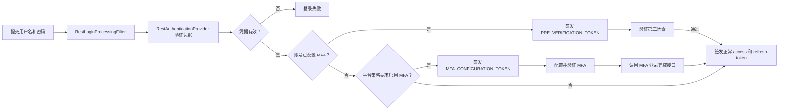
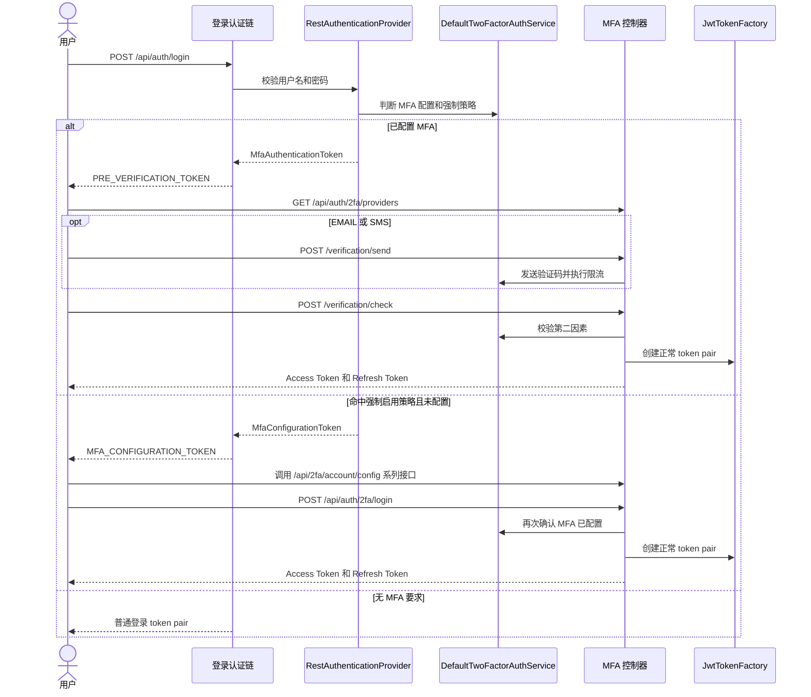
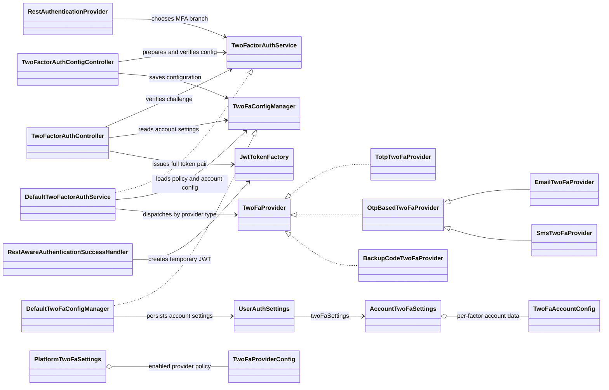

在 ThingsBoard 中，用户名和密码验证通过，不一定代表登录已经完成。如果用户启用了多因素认证（MFA），系统会先签发一个受限的临时 token；只有第二因素验证通过，客户端才会拿到正常的 access token 和 refresh token。

本文基于 ThingsBoard 本地源码版本 [`d499756`](https://github.com/thingsboard/thingsboard/tree/d499756c8d4ebe0dee37699e5ef4488dde45cdb4)，梳理 MFA 如何接入登录流程、支持哪些验证因素，以及平台如何要求用户配置 MFA。OAuth2 登录不在本文范围内。

<!--more-->

## 一、MFA 在登录流程中的位置

ThingsBoard 没有为 MFA 建立一套独立的登录过滤链。用户名密码仍由现有 Spring Security 登录链处理；凭据验证通过后，认证 Provider 根据用户 MFA 配置和平台策略选择下一步。



`RestAuthenticationProvider.authenticate()` 先检查用户是否已经配置 MFA。如果已配置，就返回 `MfaAuthenticationToken`；只有未配置时，才检查用户是否命中平台的强制策略，命中则返回 `MfaConfigurationToken`。两者都不成立时，才走普通登录成功流程。

这个顺序意味着：已配置 MFA 的用户会被要求验证第二因素，而不会被送去重新配置。策略判断位于 `DefaultTwoFactorAuthService.isEnforceTwoFaEnabled()`，它读取系统级平台设置中的用户筛选条件，再判断当前用户是否匹配。

## 二、MFA 相关 API 一览

接口分成三组：登录挑战、用户因素配置和平台策略配置。登录挑战接口使用 `/api/auth/2fa` 前缀；用户与平台配置接口使用 `/api/2fa` 前缀。

### 登录挑战

| 方法与路径 | 所需 authority | 用途与关键参数 |
| --- | --- | --- |
| `POST /api/auth/login` | 无临时 authority；提交用户名和密码 | 登录入口。密码校验后，根据 MFA 状态返回普通 token、`PRE_VERIFICATION_TOKEN` 或 `MFA_CONFIGURATION_TOKEN`。 |
| `GET /api/auth/2fa/providers` | `PRE_VERIFICATION_TOKEN` | 获取账号已配置的因素、默认因素和脱敏后的邮箱/手机号。 |
| `POST /api/auth/2fa/verification/send?providerType=EMAIL` | `PRE_VERIFICATION_TOKEN` | 为 EMAIL 或 SMS 请求发送验证码；受发送频率限制。TOTP 和 backup code 不需要发送验证码。 |
| `POST /api/auth/2fa/verification/check?providerType=EMAIL&verificationCode=123456` | `PRE_VERIFICATION_TOKEN` | 校验用户提交的因素和验证码。通过后返回正常 access/refresh token pair；失败会累计验证失败次数。 |
| `POST /api/auth/2fa/login` | `MFA_CONFIGURATION_TOKEN` | 强制配置流程的完成接口。确认账号已启用 MFA 后返回正常 token pair，否则报错。 |

这里的 `providerType`、`verificationCode` 是请求参数，不是 JSON body。`verificationCode` 的内容因因素而异：邮件/短信通常是六位数字，TOTP 是动态码，backup code 是一次性恢复码。

### 用户因素配置

| 方法与路径 | 所需 authority | 用途与关键参数 |
| --- | --- | --- |
| `GET /api/2fa/providers` | `SYS_ADMIN`、`TENANT_ADMIN`、`CUSTOMER_USER` 或 `MFA_CONFIGURATION_TOKEN` | 获取平台当前开放给用户的因素类型。 |
| `GET /api/2fa/account/settings` | `SYS_ADMIN`、`TENANT_ADMIN`、`CUSTOMER_USER` 或 `MFA_CONFIGURATION_TOKEN` | 获取当前账号已经登记的因素配置。 |
| `POST /api/2fa/account/config/generate?providerType=TOTP` | 同上 | 生成因素配置模板。TOTP 返回新的 `otpauth://` 配置；EMAIL 使用账号邮箱；SMS 返回待填写手机号的配置。 |
| `POST /api/2fa/account/config/submit` | 同上 | JSON body 提交待验证的因素配置。EMAIL/SMS 会发送验证码；TOTP 无需此步骤。 |
| `POST /api/2fa/account/config?verificationCode=123456` | 同上 | JSON body 提交因素配置并验证后保存。TOTP 在此提交动态码；backup code 无需验证码即可保存。 |
| `PUT /api/2fa/account/config?providerType=TOTP` | `SYS_ADMIN`、`TENANT_ADMIN` 或 `CUSTOMER_USER` | JSON body 设置 `useByDefault`，切换默认因素。临时配置 token 不允许调用。 |
| `DELETE /api/2fa/account/config?providerType=SMS` | `SYS_ADMIN`、`TENANT_ADMIN` 或 `CUSTOMER_USER` | 删除指定因素配置；临时配置 token 不允许调用。 |

`POST /api/2fa/account/config` 的请求体是对应 provider 的账号配置对象，`verificationCode` 是可选请求参数。对 TOTP，客户端先展示生成的二维码，用户输入动态码后直接调用该接口完成验证和保存；对 EMAIL/SMS，先调用 `submit` 发送验证码，再调用该接口验证并保存。Backup code 则由生成接口创建后直接保存。

### 平台 MFA 策略

| 方法与路径 | 所需 authority | 用途 |
| --- | --- | --- |
| `GET /api/2fa/settings` | `SYS_ADMIN` | 查询平台 MFA 设置。 |
| `POST /api/2fa/settings` | `SYS_ADMIN` | 保存 provider、验证码有效期、限流、失败锁定阈值、临时 token 有效期和强制启用用户筛选条件。 |

`/api/2fa/settings` 配置的是平台策略；`/api/2fa/account/settings` 查询的是当前用户实际登记的因素。两者名字相近，但职责不同。强制 MFA 的筛选策略从系统级设置读取。

下面的时序图把两个登录分支展开到 API 调用。邮件和短信会先请求发送验证码；TOTP 和 backup code 不经过发送接口。



## 三、临时 token 为什么不能直接访问业务 API

登录成功处理器 `RestAwareAuthenticationSuccessHandler` 会识别上述两种中间认证结果，并创建对应 authority 的临时 JWT：

- `PRE_VERIFICATION_TOKEN`：允许用户继续完成第二因素验证。
- `MFA_CONFIGURATION_TOKEN`：允许用户完成受限的 MFA 配置流程。

它们不是完整的登录 token。MFA 临时 JWT 不签发 refresh token，并使用平台设置 `totalAllowedTimeForVerification` 作为有效期；未设置时默认 30 分钟。`JwtTokenFactory` 解析这两种 scope 时，也不会恢复普通登录 token 中的完整用户资料 claims。

MFA API 通过控制器方法上的 `@PreAuthorize` 限定临时 token 的用途。比如 `TwoFactorAuthController` 中的 provider 查询、验证码发送和验证接口要求 `PRE_VERIFICATION_TOKEN`；配置控制器只在部分配置步骤允许 `MFA_CONFIGURATION_TOKEN`。因此，临时 token 即使是有效 JWT，也不能据此访问普通业务 API。

## 四、已配置用户如何完成第二因素验证

持有 `PRE_VERIFICATION_TOKEN` 的客户端通过 `TwoFactorAuthController` 完成挑战：

1. 查询当前账号可用的 MFA provider。
2. 对 EMAIL 或 SMS 方式，请求发送验证码。
3. 提交 TOTP、邮件/短信验证码或 backup code。
4. 验证通过后，由控制器签发正常的 access token 和 refresh token。

验证和发送逻辑由 `DefaultTwoFactorAuthService` 协调，具体因素的生成与校验交给 provider。发送验证码和校验验证码都有速率限制；失败次数会进入登录失败计数，达到配置的阈值后可能导致账号凭据被禁用。验证成功后会清理相关失败计数和限流状态。

| 因素 | 实现方式 | 重要细节 |
| --- | --- | --- |
| `TOTP` | 随机密钥生成 `otpauth://` 配置，使用 Aerogear verifier 校验动态码 | 密钥使用 20 字节随机值并进行 Base32 编码 |
| `EMAIL` | 向账号邮箱发送六位数字验证码 | 验证码缓存并按 provider 配置的有效期过期 |
| `SMS` | 向已配置手机号发送六位数字验证码 | 手机号校验使用 E.164 格式 |
| `BACKUP_CODE` | 使用一次性恢复码完成验证 | 码为八位小写十六进制字符串，验证成功后删除 |

邮件和短信验证码暂存在 ThingsBoard 配置的缓存中，缓存内容包括验证码、生成时间和对应的账号配置。验证成功后验证码会被移除。backup code 不能作为唯一配置的因素；用户至少还要有一个常规 MFA 因素。

### MFA 核心类图

类图按职责展示登录认证、HTTP API、MFA 协调服务、配置管理器和因素 provider 之间的关系。它省略了 DAO、审计和通知等外围依赖，突出主要调用链。



`TwoFactorAuthService` 是登录链与 MFA 实现之间的接口；`DefaultTwoFactorAuthService` 负责策略判断、限流和 provider 分发。`DefaultTwoFaConfigManager` 读写平台策略及用户因素配置。EMAIL/SMS 复用 `OtpBasedTwoFaProvider` 的验证码逻辑，TOTP 与 backup code 则各自实现 `TwoFaProvider`。

## 五、强制 MFA 用户如何完成首次配置

平台管理员可以配置强制启用 MFA 的用户筛选条件。若符合条件的用户还没有配置 MFA，密码校验通过后会得到 `MFA_CONFIGURATION_TOKEN`，而不是正常登录 token。

用户随后通过 `TwoFactorAuthConfigController` 的账号配置接口生成、提交并验证因素配置。配置完成后，客户端调用 `POST /api/auth/2fa/login`。控制器再次确认 MFA 已启用，才签发完整 token pair；配置仍未完成时，登录流程会返回错误。

这里有两个不同的操作阶段：

- 已启用 MFA 的用户持有 `PRE_VERIFICATION_TOKEN`，完成一次登录挑战。
- 被强制启用但尚未配置的用户持有 `MFA_CONFIGURATION_TOKEN`，完成首次登记。

两个 token 的权限不能互换。特别是配置 token 的可访问范围来自控制器上明确声明的 authority 检查；`MfaConfigurationPermissions` 并没有为它提供一套通用资源权限。

## 六、平台策略与用户配置分别存在哪里

平台级配置保存在 Admin Settings 的 `twoFaSettings` 项中，包含：

- 当前可用的 provider；
- 验证码有效期和发送间隔；
- 验证失败限额与校验限流；
- 临时验证 token 的有效时间；
- 是否强制 MFA，以及适用用户筛选条件。

强制策略从系统级租户的配置读取，并由系统管理员控制。用户自己登记的因素配置则保存在 `UserAuthSettings` 对应的 `user_auth_settings.two_fa_settings` 字段中。

配置管理器读取账号设置时，会移除平台已禁用的 provider；如果不存在默认因素，会选择一个可用因素作为默认值。这说明“平台允许某因素”和“用户已经配置该因素”是两件不同的事：登录分支依据用户当前有效配置判断是否需要进入 MFA 验证。

## 七、几个容易误解的安全边界

1. **密码通过不是完整登录。** MFA 用户拿到的是受限 token，必须完成第二因素才能取得正常 token pair。
2. **临时 token 的权限由端点显式限制。** 不要只因 JWT 有效，就认为它拥有普通用户的接口权限。
3. **隐藏字段不等于加密。** 用户 MFA 配置的 JSON 序列化会隐藏部分值，但这本身不能证明数据库中的敏感字段经过加密。
4. **修改 MFA 配置不代表现有登录会话立即失效。** 检查到的 MFA 配置编辑和删除路径没有主动发布普通 token 失效事件；已有正常 token 仍按常规失效机制或有效期处理。
5. **邮件和短信验证码的集群行为取决于缓存部署。** 本文确认验证码进入配置的缓存，但没有进一步核对部署中该缓存是否跨节点共享。

## 八、从零实现 MFA：给新手的最小路线

前面几节解释 ThingsBoard 当前怎么做；这一节给出一个可以用于自己项目的实现顺序。它是设计路线，不是 ThingsBoard 代码的逐行复刻。建议先做 **TOTP + 一次性恢复码**，暂缓短信、可信设备等附加机制，先把认证状态和失败路径做对。

MFA 要组合彼此独立的验证因素；密码再加一个 PIN 并不构成真正的多因素认证。TOTP 是容易落地的起点，但仍可能被实时钓鱼代理窃取；高价值系统应评估 WebAuthn/passkey 等抗钓鱼方案。OWASP 的指南也强调按应用威胁模型选择因素，而不是把所有 MFA 方式视为同等强度。

### 1. 先设计状态和数据

把账号因素状态显式区分为 `DISABLED`、`PENDING_ENROLLMENT` 和 `ENABLED`。生成密钥时只进入待确认状态；用户提交正确的一次性密码后，才切换为 `ENABLED`。不要因为生成了二维码就认为 MFA 已经生效。

建议至少记录用户 ID、因素类型、密钥或密钥引用、启用时间、最近一次已接受的 TOTP 时间步，以及待验证登录 challenge 的过期时间、失败次数和消费状态。TOTP 密钥应加密保存；恢复码只在创建时展示一次，存储可用于校验的哈希，不能把明文写入日志。

### 2. 实现 TOTP 登记

用户通过已认证的会话发起登记。服务端用密码学安全随机数生成密钥，生成标准 `otpauth://` URI 并展示二维码；用户用认证器 App 扫码后提交当前动态码。服务端验证成功才启用因素，并生成一组单次使用的恢复码。

TOTP 的客户端和服务端必须使用相同时间步。RFC 6238 建议默认 30 秒；验证器允许少量时钟偏移时，应限制允许窗口，并记录已成功接受的时间步，拒绝同一时间步内再次使用的验证码。[RFC 6238 第 5.2 节](https://www.rfc-editor.org/rfc/rfc6238.html#section-5.2)明确要求验证器不能再次接受已经成功验证过的 OTP。

自己设计 API 时，可以按职责拆成以下几个端点；路径只是示例，不是 ThingsBoard 的实际路由：

| 示例接口 | 职责 |
| --- | --- |
| `POST /me/mfa/totp/enroll` | 已登录用户发起登记，生成待确认密钥并返回一次性展示的 QR/`otpauth` 信息。 |
| `POST /me/mfa/totp/confirm` | 提交 TOTP，验证成功后启用因素并返回一次性恢复码。 |
| `POST /auth/login` | 校验主凭据；MFA 已启用时返回受限 challenge，而非完整 token。 |
| `POST /auth/mfa/verify` | 验证 challenge 和第二因素；成功消费 challenge 后签发正式 token pair。 |
| `DELETE /me/mfa/factors/{id}` | 删除因素；要求重新认证，并在符合策略时保留可用恢复方式。 |

### 3. 把密码登录和 MFA 挑战分成两个状态

密码校验通过后，如果用户没有启用 MFA，可以按普通流程签发完整 token；如果启用了 MFA，则创建短时 challenge，并返回只允许访问 MFA 验证接口的凭据。挑战凭据不应包含完整业务权限，也不应能刷新成普通 token。真正的用户会话要等第二因素验证成功后再创建。

Challenge 可保存在数据库或具备共享能力的缓存中，并至少绑定用户、过期时间、尝试次数和是否已消费。不要只在客户端保存一个“已完成 MFA”的标志；完成状态必须由服务端验证。

### 4. 验证成功后原子地消费挑战

校验第二因素时，先确认 challenge 仍有效，再验证对应因素。验证码错误时增加失败次数并应用限流；验证成功后，必须以原子操作将 challenge 从待处理状态改为已消费，只有成功消费的请求才能签发正式 token。这样两个并发请求即使同时提交同一个正确验证码，也只有一个能完成登录。

下面是说明调用顺序的伪代码，省略了具体存储、异常映射和事务实现：

```java
public TokenPair completeMfa(String challengeId, String code) {
    MfaChallenge challenge = challengeStore.requireActive(challengeId);
    User user = userService.findById(challenge.userId());

    if (!factorVerifier.matches(user, challenge.factorId(), code)) {
        challengeStore.recordFailure(challengeId);
        throw new InvalidMfaCodeException();
    }

    if (!challengeStore.consumeOnce(challengeId)) {
        throw new ExpiredOrConsumedChallengeException();
    }

    return tokenService.issueFullTokenPair(user);
}
```

`consumeOnce` 必须是带状态条件的原子更新，而不是先读取、再无条件写回。TOTP 还要独立记录因素最近成功的时间步；只消费登录 challenge 不能阻止同一个 TOTP 在另一个 challenge 中重放。

### 5. 把恢复和变更也纳入认证设计

用户更换因素、关闭 MFA 或重置恢复码时，要求重新验证现有因素或走经过审计的恢复流程。恢复流程不能成为比正常 MFA 更弱的绕过入口；恢复码应单次使用，重新生成后使旧码全部失效。OWASP 的 MFA 指南也建议提供一次性恢复码，并根据应用威胁模型评估恢复方式。[OWASP Multifactor Authentication Cheat Sheet](https://cheatsheetseries.owasp.org/cheatsheets/Multifactor_Authentication_Cheat_Sheet.html)

短信和电话验证码存在 SIM 换卡、号码转移等风险。高价值或处理敏感数据的系统，不要把短信作为唯一的强 MFA 因素；如果业务必须支持，应记录风险并设置每账号限流和监控。OWASP 当前指南将 PSTN 验证列为受限方式，并建议迁移到更强因素。

### 6. 按使用者能观察到的结果测试

- 登记：正确 TOTP 才能启用；错误或过期验证码不能启用。
- 登录：启用 MFA 后，密码正确仍只能得到临时 challenge；挑战成功后才拿到完整 token pair。
- 隔离：临时凭据不能访问业务 API，也不能调用 refresh 接口。
- 重放和并发：同一 TOTP 时间步不能重复成功；并发消费一个 challenge 时最多一个请求签发 token。
- 防爆破：验证码错误会计数；达到阈值后按策略限流或锁定；发送接口不能被无限调用。
- 恢复：恢复码只能使用一次；重新生成后旧码失效；修改或关闭因素要求重新认证。
- 强制策略：未登记的目标用户被引导完成登记；未完成登记前不会获得完整登录 token。

## 总结

ThingsBoard 的 MFA 是接在无状态 JWT 登录链中的一个阶段控制机制：凭据通过后，系统发放用途受限的临时 token；用户完成第二因素验证或强制配置后，才进入完整登录状态。平台策略决定“谁需要启用哪些因素”，用户配置记录“这个账号实际登记了什么”，验证服务和 provider 则负责挑战、限流与具体校验。

阅读或扩展这部分代码时，可以从 `RestAuthenticationProvider` 的分支开始，再沿 `RestAwareAuthenticationSuccessHandler`、`TwoFactorAuthController` 和 `DefaultTwoFactorAuthService` 追踪 token 与验证状态的变化。
