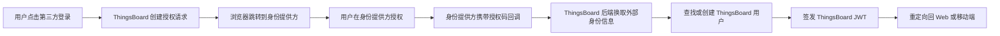
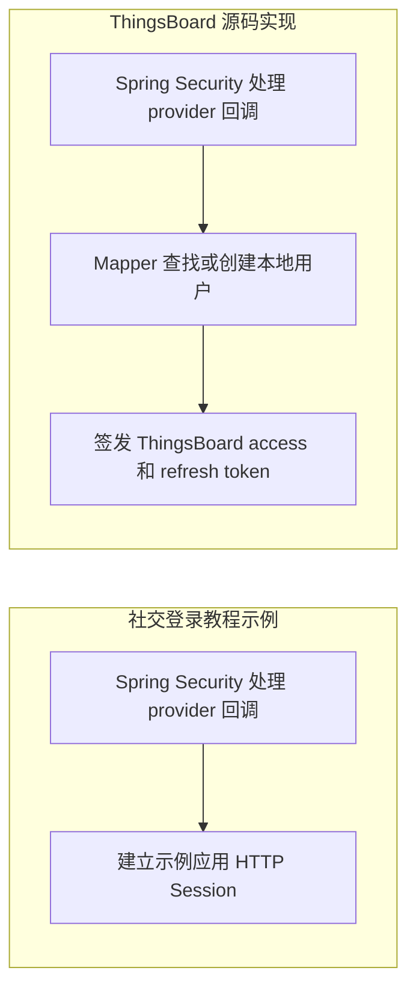
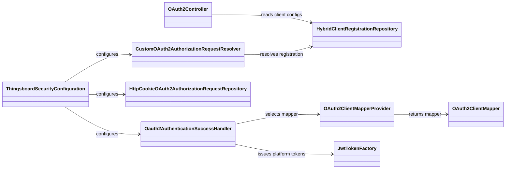
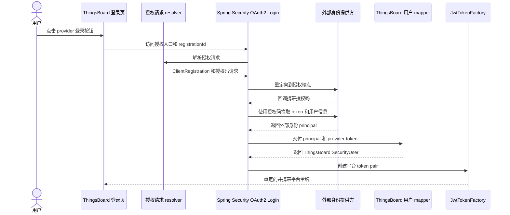

第一次读 ThingsBoard 的 OAuth2 登录代码，很容易把几个不同的东西混在一起：身份提供方的 access token、ThingsBoard 用户、ThingsBoard 自己签发的 JWT，以及 Spring Security 中的 OAuth2 登录对象。

先记住整条链路：**Spring Security 帮 ThingsBoard 向外部身份提供方完成登录；ThingsBoard 再把外部身份映射到本地用户，并签发自己的平台令牌。**

本文基于 ThingsBoard 本地源码 commit [`d499756`](https://github.com/thingsboard/thingsboard/tree/d499756c8d4ebe0dee37699e5ef4488dde45cdb4)，从配置入口开始追踪授权码登录，并补上适合初学者的组件图和阅读路线。文中的 OAuth2 指 ThingsBoard 作为 OAuth2/OIDC 客户端接入第三方登录，不是 ThingsBoard 为其他应用提供 OAuth2 授权服务器。

如果你还不熟悉 Spring Security 社交登录，可以先看 [Spring Security 实现社交登录：GitHub、Google、Facebook 与 Apple](/posts/spring-security-social-login)。那篇文章从零搭建一个社交登录示例；本文则沿 ThingsBoard 源码，继续看它如何把 Spring Security 登录结果接入自己的用户体系和 JWT 机制。

<!--more-->

## 一、先用一个例子理解 OAuth2 登录

假设用户在 ThingsBoard 登录页点击“使用 GitHub 登录”。ThingsBoard 不会把 GitHub 密码拿过来验证，而是把浏览器重定向到 GitHub。用户在 GitHub 完成授权后，GitHub 把浏览器带回 ThingsBoard，并附上一个短期授权码。

ThingsBoard 后端使用这个授权码向 GitHub 换取外部令牌和用户信息。随后，ThingsBoard 根据配置找到或创建本地用户，最后签发 ThingsBoard 自己的 access token 和 refresh token。

这里有两种令牌，不能混为一谈：

| 令牌 | 由谁签发 | 用途 |
| --- | --- | --- |
| 身份提供方 access token | GitHub、Google 等外部提供方 | 获取或验证外部用户信息；部分 mapper 会用它调用提供方 API |
| ThingsBoard access token | ThingsBoard | 访问 ThingsBoard API |
| ThingsBoard refresh token | ThingsBoard | 向 ThingsBoard 换取新的平台令牌 |

外部登录完成不代表 ThingsBoard 直接接受外部 access token。平台 API 仍然使用 ThingsBoard 自己签发的令牌。

### 和从零实现的社交登录有什么不同

[Spring Security 社交登录教程](/posts/spring-security-social-login)展示的是一个精简 Web 应用：Spring Security 完成 provider 登录后，应用建立自己的 HTTP Session，并展示用户资料。它不负责本地账号库和业务角色。

ThingsBoard 复用 Spring Security 的 OAuth2 登录协议，但在回调成功后接上了平台自己的身份和令牌体系：动态读取客户端配置，用 mapper 查找或创建 `SecurityUser`，再签发 ThingsBoard access token 和 refresh token。

| 对比点 | 社交登录教程 | ThingsBoard |
| --- | --- | --- |
| 客户端配置 | 环境变量和应用配置注册 provider | 管理界面保存到数据库，运行时动态构造 `ClientRegistration` |
| 登录成功后的身份 | 示例应用的 OAuth2 principal | 映射成 ThingsBoard `SecurityUser` |
| 登录状态 | 建立示例应用 HTTP Session | 签发 ThingsBoard access token 和 refresh token |
| 账号与授权 | 示例不包含本地账号和角色生命周期 | 按 mapper 与客户端设置查找或创建平台用户 |

可以先用教程理解 OAuth2 Login 的通用部分，再读后文的配置、mapper 和 token 工厂，重点观察 ThingsBoard 在 Spring Security 回调之后增加了哪些平台逻辑。

## 二、先从配置入口看起

ThingsBoard 的 OAuth2 登录客户端配置保存在数据库中，而不是只从 `application.yml` 里的 `spring.security.oauth2.client.registration` 静态列表读取。管理界面上的客户端表单最终保存为 `OAuth2Client` 记录；运行时再把记录转换成 Spring Security 的 `ClientRegistration`。

管理员配置大致分为两步：

1. 创建 OAuth2 客户端，填写身份提供方的客户端 ID、密钥、授权端点、令牌端点、用户信息端点、scope 和用户映射方式。
2. 将客户端绑定到 Domain，并启用该 Domain 的 OAuth2 登录。登录页才能按当前访问域名展示对应的登录按钮。

常用管理接口如下。具体权限还会受控制器上的角色和资源校验约束。

| 接口 | 用途 |
| --- | --- |
| `POST /api/oauth2/client` | 创建或保存 OAuth2 客户端配置 |
| `GET /api/oauth2/client/infos` | 分页查询客户端信息 |
| `GET /api/oauth2/client/{id}` | 查询单个客户端 |
| `DELETE /api/oauth2/client/{id}` | 删除客户端 |
| `POST /api/noauth/oauth2Clients` | 登录页匿名查询当前域名可展示的登录入口 |
| `/api/oauth2/config/template` | 管理身份提供方配置模板，用来预填常见 provider 配置 |

登录页取得的公开信息只包含按钮所需的信息，例如名称、图标和授权 URL，不会把 client secret 返回给浏览器。这个 URL 通常形如 `/oauth2/authorization/{uuid}`：它是 ThingsBoard 自己的授权入口，不是 GitHub 的授权地址。

有三个名称需要区分：

- `clientId`：身份提供方分配给 ThingsBoard 应用的客户端 ID。
- `OAuth2Client` 的 UUID：ThingsBoard 数据库记录 ID，也作为 Spring Security 的 `registrationId`。
- `ClientRegistration`：Spring Security 在运行时使用的客户端对象，由数据库配置动态构造。

## 三、核心组件各自负责什么

下面的类图只画 OAuth2 登录的主干。数据库 DAO、管理界面和每个 provider 的具体字段都省略了，先掌握主干再深入细节会更容易。

可以把它们分成四层：

1. **安全接入层**：`ThingsboardSecurityConfiguration` 把 OAuth2 Login 接入 Spring Security 过滤器链。
2. **授权请求层**：resolver 组装发往 provider 的授权请求；repository 保存请求，以便回调时找回原始请求状态。
3. **身份映射层**：success handler 选择 mapper，把外部 principal 转成 ThingsBoard 的 `SecurityUser`。
4. **平台令牌层**：`JwtTokenFactory` 根据本地用户签发平台 JWT。

Spring Security 负责通用 OAuth2 登录协议步骤，ThingsBoard 的自定义代码集中处理客户端配置、授权请求差异、用户映射和平台令牌交接。

## 四、从点击按钮到登录成功

### 1. 登录页查询可用 provider

登录页调用 `POST /api/noauth/oauth2Clients`。后端根据当前请求域名查询已启用并绑定到该 Domain 的客户端，再返回登录按钮所需的信息。移动端还会结合应用包名和平台筛选配置。

这一步决定“登录页显示哪些按钮”，不等于用户已经完成认证，也不负责验证授权回调。

### 2. resolver 创建授权请求

用户点击 `/oauth2/authorization/{registrationId}` 后，Spring Security 的授权重定向过滤器调用 `CustomOAuth2AuthorizationRequestResolver`。resolver 通过 `HybridClientRegistrationRepository` 根据 UUID 读取配置并构造 `ClientRegistration`，然后创建 OAuth2 授权码请求。

请求中包含 `state`，用于把回调和发起登录的请求关联起来。当 scope 包含 `openid` 时，代码还会添加 OIDC `nonce`；当客户端认证方式为 `NONE` 时，会添加 PKCE 参数。也就是说，OIDC 和 PKCE 是按条件加入的，不能假设每个 provider 请求都包含这两项。

### 3. 暂存请求，跳转到身份提供方

`HttpCookieOAuth2AuthorizationRequestRepository` 将授权请求序列化后放进 `oauth2_auth_request` cookie，默认有效期为 180 秒。回调到达时，Spring Security 可以恢复原始请求并检查对应状态。

Web 登录还可以保存经过校验的 `prevUri`，让登录完成后返回原页面。resolver 会根据当前请求和客户端配置展开 redirect URI；反向代理、外部域名和回调路径配置都会影响最终地址。

### 4. Spring Security 处理 provider 回调

身份提供方授权成功后，浏览器被重定向到 ThingsBoard 的登录处理路径，并携带授权码。默认处理路径前缀来自 `security.oauth2.loginProcessingUrl`，默认值是 `/login/oauth2/code/`；动态回调 URI 通常还包含 registrationId。注册到身份提供方的回调地址必须与实际展开后的 redirect URI 对上。

Spring Security 的 OAuth2 登录过滤器恢复授权请求、校验状态、使用授权码换取 provider token，并取得 `OAuth2AuthenticationToken` 和外部 principal。到此为止，Spring Security 建立的是“外部身份认证结果”，还不是 ThingsBoard API 会话。

### 5. Mapper 将外部身份映射为本地用户

`Oauth2AuthenticationSuccessHandler` 取得 provider principal、外部 access token 和对应 `OAuth2Client`，再由 `OAuth2ClientMapperProvider` 按配置选择 mapper。源码中包含 BASIC、CUSTOM、GITHUB 和 APPLE 等 mapper。

| Mapper | 大致做法 |
| --- | --- |
| BASIC | 按客户端配置指定的 principal 属性读取邮箱等信息 |
| CUSTOM | 将外部身份信息交给配置的自定义映射端点处理 |
| GITHUB | 可使用 provider access token 查询 GitHub 邮箱信息 |
| APPLE | 合并 Apple 回调中的姓名信息等属性 |

共同基类负责将身份解析到 ThingsBoard 用户。用户不存在时是否创建、创建何种角色、归属哪个 tenant/customer，取决于客户端配置和 mapper 逻辑。不要把“使用 OAuth2 登录”直接理解为“必然自动注册账号”。

### 6. 签发 ThingsBoard JWT 并重定向

找到或创建本地用户后，success handler 调用 `JwtTokenFactory.createTokenPair()` 签发 ThingsBoard access token 和 refresh token，再将用户带回 Web 页面或移动端。

注意，图中的 provider token 在 mapper 阶段用于身份映射；`JwtTokenFactory` 生成的才是 ThingsBoard 平台 token。源码当前通过重定向 URL 的 query 参数交接平台令牌。阅读或部署时应关注浏览器历史、代理访问日志和 referrer 等可能记录 URL 的位置；具体风险还取决于前端如何接收和清理参数，不能只凭后端这一处就判断整体部署是否存在漏洞。

## 五、读源码时建议按什么顺序

刚接触 Spring Security OAuth2，不建议一开始就从底层过滤器的 `attemptAuthentication()` 追起。可以按业务入口逐层往里看：

1. `ThingsboardSecurityConfiguration`：找 `.oauth2Login(...)`，看 Spring Security 接入了哪些自定义组件。
2. `OAuth2Controller`：看客户端如何保存，登录页如何查询可展示的 provider。
3. `HybridClientRegistrationRepository`：看数据库配置如何变成 Spring `ClientRegistration`。
4. `CustomOAuth2AuthorizationRequestResolver`：看授权请求 URI、state、nonce、PKCE 和 redirect URI 如何产生。
5. `HttpCookieOAuth2AuthorizationRequestRepository`：看授权请求如何跨越浏览器跳转保存到回调阶段。
6. `Oauth2AuthenticationSuccessHandler`：看 Spring 认证成功后如何进入 ThingsBoard 自己的用户体系。
7. 各个 `*OAuth2ClientMapper` 和 `JwtTokenFactory`：看身份字段如何匹配用户，以及平台令牌怎样签发。

调试时可以分别设置断点在 resolver、success handler 和 mapper 的 `getOrCreateUserByClientPrincipal()`。这样能把协议阶段和平台业务阶段分开观察：先确认 provider 回调得到什么 principal，再确认 mapper 如何选择本地用户，最后检查平台 token 是在哪里创建的。

## 六、初学者容易踩的几个坑

### 把 OAuth2 登录误认为授权服务器

本文的登录链路中，ThingsBoard 是 OAuth2 client，GitHub 等是身份提供方。它不是 OAuth2 authorization server，也没有在这条链路中给第三方应用颁发访问 ThingsBoard 的授权码。

### 把 clientId 和 registrationId 当成同一个值

clientId 由身份提供方分配；ThingsBoard 使用自己的客户端记录 UUID 作为 registrationId。登录链接里的 UUID 是 ThingsBoard 的配置标识，不是 GitHub clientId。

### 认为每个 provider 都是 OIDC

OAuth2 是授权框架，OIDC 在其上增加身份层。ThingsBoard 只在包含 `openid` scope 的场景加入 OIDC nonce；具体 provider 是否走 OIDC，要看客户端配置和 provider 能力。

### 认为外部用户信息会自动变成平台用户

mapper 控制字段提取、账号匹配和用户创建策略。理解某种 provider 的真实行为时，要继续读对应 mapper，而不能只看 OAuth2 成功 handler。

### 把回调路径写死

配置里的 `loginProcessingUrl` 是处理入口设置；实际发给 provider 的 redirect URI 由客户端 redirect 模板、registrationId、resolver 展开逻辑及外部请求信息共同决定。排查 `redirect_uri_mismatch` 时，应以运行时发出的完整 URI 和 provider 后台登记值逐字符对比。

## 七、核心源码位置

| 职责 | 源码位置 |
| --- | --- |
| 接入 Spring Security OAuth2 Login | `application/.../config/ThingsboardSecurityConfiguration.java` |
| 客户端管理与公开登录入口 | `application/.../controller/OAuth2Controller.java` |
| 生成 OAuth2 授权请求 | `application/.../config/CustomOAuth2AuthorizationRequestResolver.java` |
| 动态加载客户端注册信息 | `dao/.../oauth2/HybridClientRegistrationRepository.java` |
| 暂存授权请求 cookie | `application/.../service/security/auth/oauth2/HttpCookieOAuth2AuthorizationRequestRepository.java` |
| 登录成功和失败处理 | `application/.../service/security/auth/oauth2/Oauth2AuthenticationSuccessHandler.java`、`Oauth2AuthenticationFailureHandler.java` |
| mapper 选择与身份映射 | `application/.../service/security/auth/oauth2/` 下的 `OAuth2ClientMapper` 和各 provider mapper |
| 签发平台 JWT | `application/.../service/security/model/token/JwtTokenFactory.java` |

读完这条主链路后，可以再分别深入每个 mapper、客户端配置表和前端接收 token 的页面。最重要的是始终区分三个阶段：**外部协议认证、本地用户映射、ThingsBoard 平台令牌签发**。这也是理解 ThingsBoard OAuth2 登录实现的关键。
