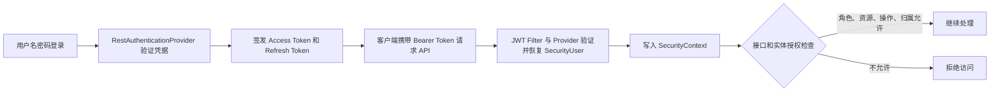
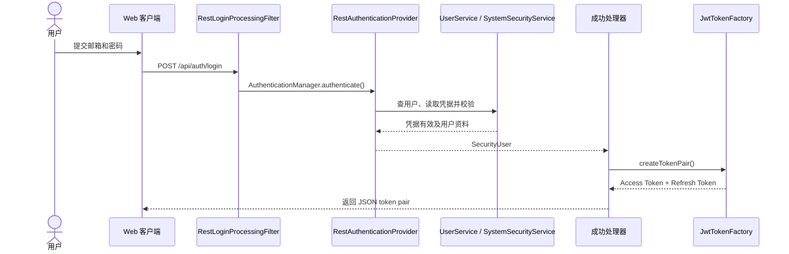
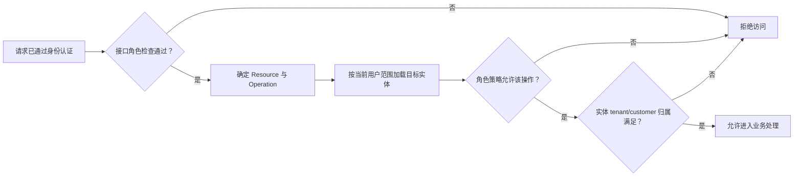

看 ThingsBoard 的安全代码时，最容易混淆的是认证和授权：请求通过 JWT 验证，只能说明系统知道它代表哪个用户；这个用户能不能读取某台设备，还要看角色、操作类型和设备归属。

本文根据 ThingsBoard 本地源码梳理普通用户登录、JWT 请求认证和资源权限检查，并简要说明 MFA 与 OAuth2 在整体流程中的位置。示例代码链接固定到本次阅读的源码版本 [`d499756`](https://github.com/thingsboard/thingsboard/tree/d499756c8d4ebe0dee37699e5ef4488dde45cdb4)，避免后续主分支变动造成代码位置与描述不一致。

<!--more-->

## 一、先看整体分层

ThingsBoard 的 HTTP 安全处理可以概括为三步：

1. Spring Security 过滤器解析凭据并验证身份。
2. 验证结果转成 `SecurityUser`，放进 `SecurityContext`。
3. Controller 或 Service 再检查用户角色、资源类型、操作和实体归属。



安全链配置在 [`ThingsboardSecurityConfiguration`](https://github.com/thingsboard/thingsboard/blob/d499756c8d4ebe0dee37699e5ef4488dde45cdb4/application/src/main/java/org/thingsboard/server/config/ThingsboardSecurityConfiguration.java)。它启用方法级安全，普通 HTTP API 使用无状态策略；请求不会依赖传统的服务端登录 Session。

## 二、用户名密码如何变成 JWT

`POST /api/auth/login` 由 [`RestLoginProcessingFilter`](https://github.com/thingsboard/thingsboard/blob/d499756c8d4ebe0dee37699e5ef4488dde45cdb4/application/src/main/java/org/thingsboard/server/service/security/auth/rest/RestLoginProcessingFilter.java) 接收。过滤器解析用户名和密码，创建 Spring Security 的认证请求，交给 `AuthenticationManager`。

`RestAuthenticationProvider` 按邮箱查找用户及其凭据，再调用 `SystemSecurityService` 校验密码和凭据状态。验证通过后，它把用户资料包装成 `SecurityUser`。普通登录成功时，`RestAwareAuthenticationSuccessHandler` 调用 [`JwtTokenFactory`](https://github.com/thingsboard/thingsboard/blob/d499756c8d4ebe0dee37699e5ef4488dde45cdb4/application/src/main/java/org/thingsboard/server/service/security/model/token/JwtTokenFactory.java) 创建 access token 和 refresh token，并以 JSON 返回。

把这段过程展开，职责是分开的：登录过滤器只负责读取 HTTP 请求；认证 Provider 负责核对用户和凭据；成功处理器负责响应；Token Factory 才负责生成签名 token。



两种 token 的用途不同。Access token 用于 API 请求，scope 表示用户 authority，并包含 user ID 以及可用的 tenant/customer 信息；Refresh token 使用专门的 `REFRESH_TOKEN` scope，只用于换取新 token，不能代替 access token 访问普通 API。签名和有效期由 `JwtTokenFactory` 根据 `JwtSettingsService` 提供的设置处理。

客户端后续通过 `X-Authorization: Bearer ...` 或 `Authorization: Bearer ...` 发送 access token。旧版 `X-Authorization` 和标准 `Authorization` 都被 header extractor 接受。

刷新请求走独立的 `POST /api/auth/token` 过滤器。Provider 先解析 refresh token、检查 scope 和有效期，再按用户 ID 重新读取用户认证信息，避免只凭 token 里的旧资料恢复用户。验证通过后，成功处理器再签发新的一对 token。

登出接口会记录审计事件并发布 Session 失效事件；改密和重置密码会发布用户凭据失效事件。`DefaultTokenOutdatingService` 订阅这些事件，将时间写入失效缓存。认证 access 或 refresh token 时，服务会比较 token 的签发时间与用户 ID、session ID 对应的失效时间。因此登出不是清除服务端 HTTP Session，而是让该 session 在失效时间之前签发的 token 不再通过检查；客户端也需要清理本地凭据。

## 三、后续请求怎样建立认证上下文

对于受保护的 `/api/**` 请求，`JwtTokenAuthenticationProcessingFilter` 从请求头提取 Bearer token，并交给 `JwtAuthenticationProvider`。Provider 调用 `JwtTokenFactory.parseAccessJwtToken()` 验证签名、有效期和 scope，再调用 `TokenOutdatingService` 检查 token 是否已被撤销。

核心校验集中在 [`JwtAuthenticationProvider.authenticate()`](https://github.com/thingsboard/thingsboard/blob/d499756c8d4ebe0dee37699e5ef4488dde45cdb4/application/src/main/java/org/thingsboard/server/service/security/auth/jwt/JwtAuthenticationProvider.java)：

```java
SecurityUser securityUser = tokenFactory.parseAccessJwtToken(accessToken);
if (tokenOutdatingService.isOutdated(accessToken, securityUser.getId())) {
    throw new JwtExpiredTokenException("Token is outdated");
}
return new JwtAuthenticationToken(securityUser);
```

成功后，过滤器创建 Spring `SecurityContext`，把认证对象写入 `SecurityContextHolder` 并继续执行请求链。Controller 可以通过 `BaseController.getCurrentUser()` 取到 `SecurityUser`。这是无状态认证：每个请求都携带凭据，并独立恢复当前用户，不依靠上一次请求留下的 HTTP Session。

请求被认证不等于授权完成。JWT 中的角色和租户信息帮助系统恢复身份上下文，但具体实体是否允许访问，仍需要后续权限检查。

## 四、角色和资源权限在哪里判断

平台主要有三种用户角色：`SYS_ADMIN`、`TENANT_ADMIN` 和 `CUSTOMER_USER`。Spring 方法安全通过 `@PreAuthorize` 检查接口是否接受当前角色。例如管理接口可能只允许系统管理员或租户管理员调用。

这里的 `Authority` 是 ThingsBoard 定义的角色枚举。`SecurityUser.getAuthorities()` 会把当前角色转换成 Spring Security 的 `GrantedAuthority`，供 `hasAuthority` / `hasAnyAuthority` 判断。JWT 的 `scopes` claim 也会写入这个 authority 名称；在这条用户登录路径里，它表达用户角色，不是 OAuth2 中按资源授权的 scope。枚举中还包含 `REFRESH_TOKEN`、预验证等 token 用途标记，它们不是第四种用户角色。

例如 [`AuthController.getUser()`](https://github.com/thingsboard/thingsboard/blob/d499756c8d4ebe0dee37699e5ef4488dde45cdb4/application/src/main/java/org/thingsboard/server/controller/AuthController.java) 允许三类已登录用户读取当前用户资料：

```java
@PreAuthorize("hasAnyAuthority('SYS_ADMIN', 'TENANT_ADMIN', 'CUSTOMER_USER')")
@GetMapping(value = "/auth/user")
```

这个注解只判断当前 authority 是否在允许集合中，不判断请求者是否能访问任意其他用户或实体；后者仍需相应的数据范围检查。

资源级检查由 `AccessControlService` 承担。`DefaultAccessControlService` 根据用户 authority 选择 `SysAdminPermissions`、`TenantAdminPermissions` 或 `CustomerUserPermissions`，再按 `Resource` 找对应的 `PermissionChecker`。检查输入可以包含：

- **角色**：用户属于哪一类管理员或客户用户。
- **资源**：设备、资产、客户、仪表板等资源类型。
- **操作**：读取、写入、删除、读取遥测或远程调用等。
- **实体范围**：目标实体属于哪个 tenant 或 customer，或仪表板是否分配给该 customer。

`BaseController` 的实体检查辅助方法通常先用当前用户的 tenant 查询实体，再将实体及操作交给权限服务。`AccessValidator` 也提供一条按实体类型加载对象并执行权限检查的路径。每个 API 的实际保护方式仍要沿对应 Controller 和 Service 调用确认，不能假设所有入口都经过同一个检查器。

例如，`BaseController.checkEntity()` 把已加载的实体类型、操作和实体本身传给权限服务：

```java
accessControlService.checkPermission(
        user,
        Resource.of(entity.getId().getEntityType()),
        operation,
        entity.getId(),
        entity);
```

`DefaultAccessControlService` 随后按用户 authority 和资源类型选出 checker，再判断该操作及实体范围是否允许。这里传入实体对象很关键：仅看资源类型和操作，还不足以判断 tenant/customer 归属。

三种角色的范围并不相同。系统管理员拥有较广的平台管理权限，但资源映射仍可能限制可操作范围；租户管理员通常只能操作本租户的数据；客户用户则进一步受 customer 归属和操作白名单约束。新增接口时，既要确认角色注解，也要确认目标实体加载和归属检查。

可以把一次资源授权理解为以下判定链。任何一步不满足，访问就会被拒绝；实体检查也可能发生在调用权限服务之前，例如先按当前 tenant 查找对象。



下面是角色边界的概览。它不是完整权限矩阵；不同 `Resource` 会绑定不同 checker，具体操作还可能受 `@PreAuthorize` 和业务逻辑约束。

| 角色 | 常见范围 | 代码中的典型约束 |
| --- | --- | --- |
| `SYS_ADMIN` | 平台级管理 | 对系统级实体执行检查；一些资源只开放特定操作，并非所有资源一律放行 |
| `TENANT_ADMIN` | 当前租户 | 多数实体检查 tenant ID 相同；具体 API 仍可能用方法安全限制角色或操作 |
| `CUSTOMER_USER` | 当前租户中的指定客户 | 设备、资产等还要匹配 customer；仪表板须分配给该 customer；设备相关操作另有允许列表 |

例如，客户用户访问设备时，checker 先检查操作是否在允许列表中，再检查设备 tenant 是否匹配，最后检查设备是否关联到该 customer。`CLAIM_DEVICES` 是一个有意的例外：满足同一 tenant 后，它不要求设备已经属于当前 customer，否则就无法认领尚未分配的设备。这类操作例外说明，不能只根据角色名称推断权限。

## 五、MFA、OAuth2 与其他认证入口

MFA 接在用户名密码认证之后。若用户需要完成额外验证，认证提供者会返回受限的临时认证结果，成功处理器签发预验证 token；完成后续验证才进入完整登录状态。MFA 具体挑战流程不在本文展开。

OAuth2 是另一条登录入口。`ThingsboardSecurityConfiguration` 仅在 OAuth2 配置存在时启用 `oauth2Login()`，并连接专用成功和失败处理器。它完成外部身份验证后，仍会接入 ThingsBoard 自己的认证上下文和 token 体系。

此外，API Key 认证由单独的过滤器和 Provider 处理，并映射回关联用户的权限；设备 API `/api/v1/**` 则不走浏览器用户的 JWT 过滤器，使用设备接入侧的认证方式。WebSocket 路径在 HTTP 安全链中单独放行，不能仅凭 HTTP 规则判断 WebSocket 会话后续的认证行为。

## 六、阅读源码时要记住的边界

- `authenticated()` 只回答“请求是否有身份”，不回答“这个身份能否访问目标实体”。
- `@PreAuthorize` 负责接口级角色门槛，资源操作和 tenant/customer 归属往往还要由 `AccessControlService` 检查。
- 权限策略分散在 Controller、Service、`BaseController` 和 `AccessValidator` 等路径中。需要确认某个接口安全性时，应沿实际调用链检查，而不是只搜索一处注解。
- 配置中的 `.anyRequest().permitAll()` 说明不能把默认过滤链当成全局拒绝策略。新接口应核对路径匹配、认证过滤器和方法/领域授权是否都覆盖。

整体上，Spring Security 负责请求凭据和认证上下文，ThingsBoard 的权限服务负责平台角色及实体范围。理解这两个边界，才能判断一个请求到底是“登录了”，还是“确实有权操作这份数据”。
