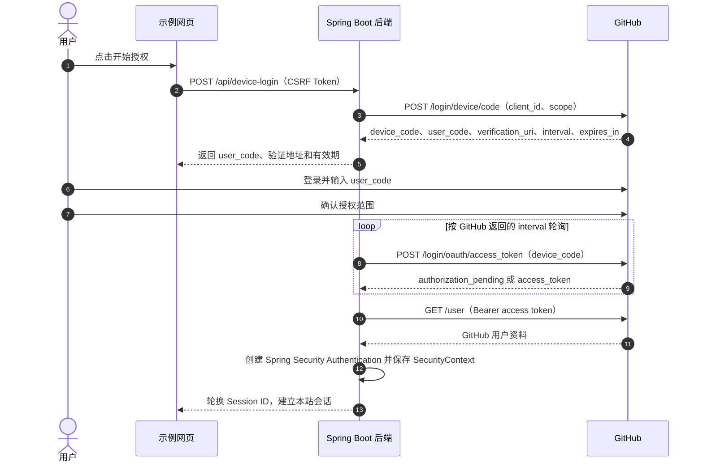

GitHub Device Flow 让没有方便浏览器跳转能力的设备先显示一组短码，用户再到 GitHub 网页输入短码并确认授权。GitHub 文档将它定位为 CLI 等无头应用的授权方式。本文用电脑网页展示设备码，帮助理解完整过程；普通网站的“使用 GitHub 登录”通常更适合授权码流程。

本文先讲协议和安全边界，再创建 Spring Boot 项目并实现一条可操作的 Device Flow。示例使用 Spring Boot 4.1.2、Java 25、Spring Security 和蓝白配色前端。GitHub 只需提供 OAuth App 的 Client ID；Device Flow 不需要 Client Secret。示例使用 `RestClient` 调 GitHub 授权接口，Spring Security 则负责本站的认证会话。

<!--more-->

## 一、先理解 GitHub Device Flow

设备流程里有两种代码，作用不同：

- `user_code` 是短码，显示给用户，让用户在 GitHub 页面输入并确认。
- `device_code` 是设备端凭证，服务端用它轮询授权结果。它不能显示给浏览器或写入日志。

这两种代码都短时有效，但它们不能互相替代。用户输入 `user_code` 并确认后，GitHub 才会让服务端用 `device_code` 换取 access token。



GitHub 的步骤是：服务端请求设备码和用户码；用户在 `https://github.com/login/device` 输入用户码；服务端按返回的间隔轮询令牌接口；收到授权后再调用 GitHub API。[GitHub Device Flow 文档](https://docs.github.com/en/apps/oauth-apps/building-oauth-apps/authorizing-oauth-apps#device-flow)

### Spring Security OAuth2 Client 会自动实现 Device Flow 吗？

不会。Spring Security 的 `oauth2Login()` 实现的是 Authorization Code Grant；OAuth2 Client 的授权客户端也没有开箱即用的 Device Authorization Grant 流程。[Spring Security OAuth2 Login 文档](https://docs.spring.io/spring-security/reference/servlet/oauth2/login/index.html) [授权类型文档](https://docs.spring.io/spring-security/reference/servlet/oauth2/client/authorization-grants.html)

因此，本文示例的分工是：

- `GitHubDeviceFlowClient` 用 Spring `RestClient` 调用 GitHub 设备码、令牌和用户信息接口。
- 应用服务保存短时设备授权事务、按 GitHub 的间隔轮询，并处理待批准、拒绝、过期和限速状态。
- Spring Security 负责 CSRF、接口访问控制、Session ID 轮换，以及 `SecurityContext` 的保存和恢复。

这仍然是 Spring Security 管理的登录，但设备授权协议由应用显式调用 GitHub API。若要把它封装成 Spring Security OAuth2 Client 自定义授权扩展，还需要编写并集成自定义 grant 支持；仅添加 `spring-boot-starter-oauth2-client` 和 YAML 配置并不会得到 Device Flow。

## 二、创建 GitHub OAuth App

在 GitHub 中打开 **Settings → Developer settings → OAuth Apps → New OAuth App**，填写应用名称和 Homepage URL。注册表单还要求填写 Authorization callback URL；本地教程可填 `http://localhost:8080/`。Device Flow 本身不发送授权回调，因此该 URL 不参与此流程。

创建应用时启用 **Enable Device Flow**，然后注册应用并复制 **Client ID**。之后可在 OAuth App 设置中调整 Device Flow 选项。[GitHub 创建 OAuth App 指南](https://docs.github.com/en/apps/oauth-apps/building-oauth-apps/creating-an-oauth-app)

配置只需要 Client ID。不要把 Client Secret 配到示例里，也不要粘贴到聊天、前端代码或 Git 仓库。若应用设置中没有启用 Device Flow，GitHub 会返回 `device_flow_disabled`。

示例请求 `read:user`，只读取基本用户资料，不请求仓库权限。每次取得 access token 后，服务端都用它调用 `/user` 重新核验用户身份。GitHub 文档特别提醒，不要假设用户授权前后使用的是同一个 GitHub 账号。

## 三、创建 Spring Boot 项目

项目可以使用 Spring Initializr 创建，也可以使用 `spring-boot-developer` 技能生成。前端再由 `oil-ui` 技能设计和实现。

### 方式一：使用 Spring Initializr

打开 [Spring Initializr](https://start.spring.io/)，创建 Maven 项目并选择：

- Spring Boot：`4.1.2`
- Language：Java
- Java：`25`
- Dependencies：Spring Security、Spring Web MVC、Spring RestClient、Spring Jackson

Boot 4 中对应的 Starter 是 `spring-boot-starter-security`、`spring-boot-starter-webmvc`、`spring-boot-starter-restclient` 和 `spring-boot-starter-jackson`。示例不需要数据库：用户资料仅放在 HTTP Session 中，不创建持久化账号。

### 方式二：用 `spring-boot-developer` 和 `oil-ui` 技能

安装 [spring-boot-developer](https://github.com/zhijunio/skills/tree/main/spring-boot-developer) 和 [oil-ui](https://github.com/oil-oil/oil-ui) 后，在项目父目录使用下面的提示词：

```text
请使用 spring-boot-developer 技能创建名为 spring-security-github-device-flow-demo 的独立项目，使用 Spring Boot 4.1.2、Java 25、Maven、Spring Security、Spring Web MVC、Spring RestClient 和 Spring Jackson。

实现 GitHub OAuth App Device Flow：
- 仅从环境变量读取 GITHUB_CLIENT_ID；不要读取或要求配置 Client Secret。
- 请求 read:user scope，处理 authorization_pending、slow_down、access_denied 和过期状态；轮询遵守 GitHub 返回的间隔。
- device_code 只保留在服务端；网页只显示 user_code 和验证地址。
- 用服务端请求 GitHub /user 重新核验身份，再建立 Spring Security HTTP Session；保留 CSRF，认证时轮换 Session ID。
- 说明 OAuth2 Login 默认是 Authorization Code Grant，不能仅靠 spring-boot-starter-oauth2-client 配置获得 Device Flow。
- 说明演示用户不持久化；设备事务存于进程内存，项目适合本地单实例学习。

前端请使用 oil-ui 技能设计蓝白配色的桌面登录流程页面：显示用户码、GitHub 验证入口、授权状态与剩余时间，并提供等待、拒绝、过期、失败和已登录状态。不要伪造成功状态。

补充中英文 README、GitHub OAuth App 的设置步骤和真实操作验证步骤。Client ID 由用户本地通过环境变量配置，不要写入仓库。
```

## 四、配置 Client ID 并运行

将 OAuth App 的 Client ID 放在启动应用的同一个终端环境中。zsh 或 bash 示例：

```sh
export GITHUB_CLIENT_ID='your-github-oauth-app-client-id'
./mvnw spring-boot:run
```

也可以复制 `.env.sample` 为 `.env` 并填入 `GITHUB_CLIENT_ID`；示例应用会导入该文件。修改配置后需要重启服务。

访问 <http://localhost:8080>。前端提供三步操作：生成设备码、前往 GitHub 授权、返回本站。页面未启用时会提示先配置 Client ID；不要为了截图或演示写入一个假 Client ID。

如果页面仍提示未配置，先打开 <http://localhost:8080/api/config>。返回 `{"clientConfigured":true}` 表示该服务进程已经读取到配置；修改环境变量后必须重启应用，再强制刷新登录页。

下图是服务端已读取 Client ID、尚未开始授权时的页面状态。点击按钮后，应用才会向 GitHub 申请真实的设备码。


*图：本地运行页面；设备码仅在用户开始授权后由 GitHub 实时生成。*

关键配置如下：

```yaml
github:
  device-flow:
    client-id: ${GITHUB_CLIENT_ID:}
    scope: read:user
```

Web Session Cookie 使用 `HttpOnly` 和 `SameSite=Lax`；本地 HTTP 演示默认不启用 `Secure`。通过 HTTPS 部署时设置 `SESSION_COOKIE_SECURE=true`。

## 五、实现设备码申请和轮询

### 向 GitHub 申请设备码

服务端向 `POST https://github.com/login/device/code` 发送表单，带 `client_id` 和 scope。响应包含 `device_code`、`user_code`、`verification_uri`、`interval` 和 `expires_in`。GitHub 默认用户码有效期是 15 分钟，轮询间隔默认 5 秒；程序必须采用响应中的时间值，而不是自行固定轮询频率。

`GitHubDeviceFlowClient` 只向页面返回验证链接前校验它确实是 GitHub 的 HTTPS 设备验证地址。DTO 将 GitHub 的 snake_case 字段映射到 Java 属性：

```java
public record DeviceAuthorization(
        @JsonProperty("device_code") String deviceCode,
        @JsonProperty("user_code") String userCode,
        @JsonProperty("verification_uri") String verificationUri,
        @JsonProperty("expires_in") Long expiresIn,
        Integer interval) {}
```

服务端使用随机不透明的登录事务 ID，将设备事务绑定到发起请求的 HTTP Session。API 响应只包含事务 ID、`user_code`、验证地址、有效期和轮询提示；`device_code` 从不发给前端。

### 按间隔轮询并处理状态

轮询接口 `POST https://github.com/login/oauth/access_token` 要求 `client_id`、`device_code` 和 grant type：

```text
urn:ietf:params:oauth:grant-type:device_code
```

示例按 GitHub 返回的 `interval` 控制服务端请求频率，并处理这些结果：

| GitHub 返回 | 示例处理 |
| --- | --- |
| `authorization_pending` | 保持等待，按原间隔继续轮询 |
| `slow_down` | 在当前间隔上增加 5 秒再继续 |
| `access_denied` | 将登录事务标记为拒绝并停止轮询 |
| `expired_token` / `token_expired` | 标记过期，需要重新申请设备码 |
| `access_token` | 服务端使用令牌请求 GitHub `/user` |

GitHub 对 `slow_down` 的要求是将最小轮询间隔增加 5 秒；用户拒绝或代码过期后，当前代码不能继续使用。[GitHub Device Flow 错误说明](https://docs.github.com/en/apps/oauth-apps/building-oauth-apps/authorizing-oauth-apps#device-flow)

### 用 GitHub 身份建立本站 Session

GitHub access token 只在服务端用于调用 `GET https://api.github.com/user`。获得用户资料后，示例将 GitHub 的数字用户 ID、用户名和头像放进当前登录主体，再调用 `SessionAuthenticationStrategy` 轮换 Session ID，创建并保存 Spring Security `SecurityContext`：

```java
var authentication = UsernamePasswordAuthenticationToken.authenticated(
        gitHubUser,
        null,
        List.of(new SimpleGrantedAuthority("ROLE_USER")));

sessionAuthenticationStrategy.onAuthentication(authentication, request, response);
SecurityContext context = SecurityContextHolder.createEmptyContext();
context.setAuthentication(authentication);
SecurityContextHolder.setContext(context);
securityContextRepository.saveContext(context, request, response);
```

随后 `GET /api/me` 通过 Spring Security 要求认证：登录前返回 `401`，登录后返回 Session 中的 GitHub 用户资料。登出使用受 CSRF 保护的 `POST /api/logout`。

这里没有把 GitHub access token 当成本地 Session，也没有把它传到浏览器。示例也没有数据库，因此并未把 GitHub 用户注册为持久化的本站账号；真实应用需要用 GitHub 稳定 ID 关联本地用户，并从本地加载角色与权限。

## 六、如何验证

### 先检查应用配置

1. 确认 OAuth App 已启用 **Device Flow**。
2. 将 Client ID 设置到运行应用的终端环境，并重启应用。
3. 打开 <http://localhost:8080>，确认「开始 GitHub 授权」按钮可用。
4. 登录前直接访问 `http://localhost:8080/api/me`，应得到 `401`。

### 走完真实 GitHub 授权

1. 点击「开始 GitHub 授权」，检查页面生成短码并显示剩余时间。


*图：页面已从 GitHub 收到真实设备码，正等待用户在 GitHub 完成授权。图中 user code 是短时一次性代码，运行时请使用页面新生成的代码，不要照抄文章截图。*

2. 点击「打开 GitHub 验证页」，登录 GitHub 并输入页面上的用户码。
3. 确认授权范围只有 `read:user`。
4. 回到示例页面，等待它按服务端间隔轮询；成功后应显示 GitHub 用户信息。
5. 再访问 `/api/me`，确认得到用户 JSON；点击「退出登录」后再访问，应恢复为 `401`。

同时验证拒绝授权、用户码过期、GitHub 未开启 Device Flow、错误 Client ID、网络异常和登出。拒绝或过期时页面应停止轮询并允许重新开始；未配置 Client ID 时按钮保持禁用。真实 Device Flow 测试必须使用已启用该功能的 OAuth App；不要用假设备码或假用户资料冒充平台授权成功。

## 七、示例的适用范围

GitHub 官方将 Device Flow 用于 CLI 等无头应用。本文用网页来模拟设备端界面，只是为了让读者在一台电脑上完整观察设备码和授权状态；这不意味着 Device Flow 是一般网站登录的首选方案。普通 Web 应用可优先考虑 Spring Security `oauth2Login()` 提供的 Authorization Code Grant。

示例的设备事务保存在进程内存，单实例下便于学习。多实例部署需要共享且有过期清理的事务存储，并处理并发轮询、实例切换与重放；生产登录还需要持久化本地账号映射、权限管理、审计和适当的资源保护。

## 总结

GitHub Device Flow 先让服务端申请设备码，再由用户在 GitHub 网页输入短码授权；服务端按 GitHub 的间隔轮询，拿到令牌后查询 `/user` 并建立本站会话。`user_code` 用于用户确认，`device_code` 和 access token 始终留在服务端。Spring Security 管理本地认证和 Session；示例中的 Device Flow HTTP 调用由 `RestClient` 显式完成。运行演示只需要 Client ID，不需要 Client Secret。
