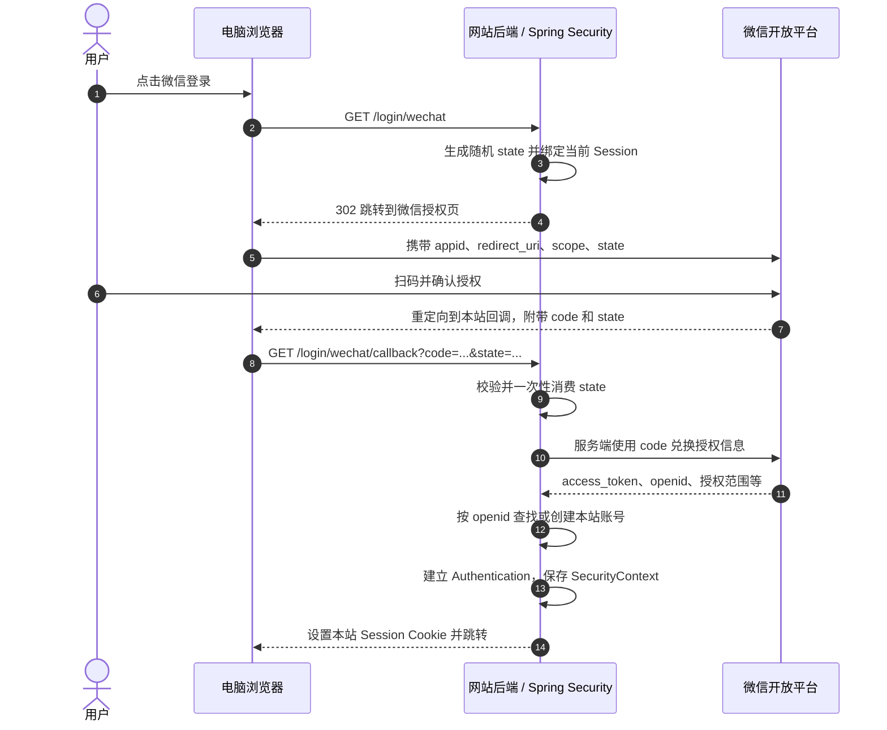

上一篇介绍自建扫码登录：应用自行生成二维码票据并维护状态。本文改用微信开放平台网站应用，由微信完成用户授权，本站校验回调后建立自己的登录会话。

> 微信扫码成功不等于本站已经登录。网站必须校验授权回调、取得微信用户标识，并将该身份映射到本站账号后，才能创建本站会话。

本文介绍微信开放平台的**网站应用微信登录**，不同于公众号网页授权、小程序登录和自建二维码登录。示例使用 Spring Boot 4.1.2、Spring Security。真实扫码需要已审核的网站应用和可访问的回调地址。

完整示例项目：[spring-security-wechat-qr-login-demo](https://github.com/zhijunio/spring-security-wechat-qr-login-demo)。仓库包含可运行代码、英文 README 和中文说明。仓库采用跨设备短时登录事务：微信回调只批准事务，电脑端轮询并确认后才建立本站会话。下文的代码片段聚焦授权码回调和身份映射，采用较精简的直接回调模式；类名、接口和会话建立时机与仓库实现不逐行对应。

<!--more-->

## 一、先理解授权流程

微信网站应用登录使用 OAuth 2.0 授权码流程。网站把浏览器引导至微信授权页，微信确认用户授权后把临时 `code` 返回给网站。网站服务端用 `code` 向微信换取该应用下的 `openid`，再决定如何登录本站。



微信 `access_token` 用于访问微信接口；本站的 Spring Security Session 用于访问本站页面和接口。两者不能互相替代，也不应把微信令牌发给浏览器充当本站凭证。


*图：微信身份经本站核验后，网站创建自己的会话。配图使用 [Ian Xiaohei Illustrations](https://github.com/helloianneo/ian-xiaohei-illustrations) 技能生成。*

## 二、接入前需要准备什么

先在微信开放平台创建网站应用、申请微信登录能力并按要求完成审核和域名配置。服务端需要 `AppID`、`AppSecret` 和与平台配置一致的回调地址；线上使用 HTTPS。[微信登录开发指南](https://developers.weixin.qq.com/doc/oplatform/Website_App/WeChat_Login/Wechat_Login.html)

微信无法回调到仅本机可访问的 `localhost`。本地联调可使用自己控制的 HTTPS 测试域名或安全隧道。没有已审核的网站应用时，只能验证本站逻辑，不能完成真实扫码授权。

还要留意，微信客户端可能提供桌面快速登录等体验，授权页不一定每次都只显示二维码。因此，称为“微信网站应用登录”或“微信扫码授权”更准确。

## 三、创建 Spring Boot 项目

项目可以用 Spring Initializr 手动搭建，也可以让 `spring-boot-developer` 技能生成。

### 方式一：使用 Spring Initializr

使用 [Spring Initializr](https://start.spring.io/) 创建 Maven 项目，选择 Spring Boot 4.1.2、Java 25，并添加 Spring Web（MVC）、Spring Security 和 Spring RestClient。Boot 4 对应的依赖分别是 `spring-boot-starter-webmvc`、`spring-boot-starter-security` 和 `spring-boot-starter-restclient`。示例直接适配微信接口，不依赖微信 Java SDK；Spring Security 管理本站认证和 Session。

基础示例不需要 `spring-boot-starter-security-oauth2-client`。关于使用 OAuth2 Client 的改造条件，见“把已验证身份交给 Spring Security”一节。

### 方式二：使用 `spring-boot-developer` 技能

在支持 Skills 的 Codex 中，可按[技能仓库说明](https://github.com/zhijunio/skills/tree/main/spring-boot-developer)安装 `spring-boot-developer`，然后在项目父目录中使用下面的提示词。技能会创建项目并按 Spring Boot 项目约定实现；提示词明确了本教程的微信网站应用授权流程和安全边界：

```text
请使用 spring-boot-developer 技能，在当前目录创建一个名为 spring-security-wechat-qr-login-demo 的独立示例项目。

要求：
- 使用 Spring Boot 4.1.2、Java 25、Maven，添加 Spring Web（MVC）、Spring Security 和 Spring RestClient。
- 演示微信开放平台“网站应用微信登录”，不要实现公众号网页授权、小程序登录或自建扫码协议。
- 提供电脑端登录页：生成并展示微信授权二维码，创建绑定当前浏览器 HTTP Session 的短时登录事务，并轮询事务状态。
- 实现微信授权回调：校验一次性、有过期时间的 state；在服务端使用 code、AppID 和 AppSecret 兑换 openid；授权成功后批准对应的浏览器登录事务。
- 电脑浏览器确认已批准的事务后，通过 Spring Security 建立自己的认证会话并轮换 Session ID。保持 CSRF 保护。
- AppID、AppSecret 和 HTTPS 回调地址只从服务端环境变量读取；不要将密钥发送到前端、写入日志或提交到 Git。
- 前端使用简洁的蓝白配色；提供清楚的本地启动、自动化验证和真实微信授权配置说明。
- 明确说明真实扫码需要符合微信开放平台要求且已审核的网站应用和可访问的 HTTPS 回调；不要伪造微信登录成功。
- 使用 Apache License 2.0，不添加 CI 配置。
```

配置文件只引用环境变量，不提交真实密钥：

```yaml
wechat:
  login:
    app-id: ${WECHAT_APP_ID}
    app-secret: ${WECHAT_APP_SECRET}
    callback-url: ${WECHAT_CALLBACK_URL}
```

启动前设置 `WECHAT_APP_ID`、`WECHAT_APP_SECRET` 和 `WECHAT_CALLBACK_URL`。`AppSecret` 只保存在服务端配置或密钥管理服务中，不能写入前端、二维码、日志或 Git 仓库。

定义配置属性：

```java
@ConfigurationProperties("wechat.login")
public record WechatLoginProperties(
        String appId,
        String appSecret,
        URI callbackUrl) {
}
```

在应用配置中启用 `@ConfigurationPropertiesScan`，并用 Spring 管理 `RestClient`。调用微信接口时配置有限的连接和读取超时；对微信返回的 `errcode`、缺失字段和非成功响应都要按登录失败处理。

## 四、发起微信授权

点击登录按钮时，浏览器应进行顶层页面跳转，而不是用 `fetch` 请求跨站授权地址。后端生成不可预测的 `state`，存入当前浏览器的服务端 Session，然后拼出微信授权地址：

```text
https://open.weixin.qq.com/connect/qrconnect
  ?appid=WECHAT_APP_ID
  &redirect_uri=URL_ENCODED_CALLBACK_URL
  &response_type=code
  &scope=snsapi_login
  &state=RANDOM_ONE_TIME_VALUE
  #wechat_redirect
```

`redirect_uri` 必须进行 URL 编码，`scope` 使用网站应用登录规定的 `snsapi_login`。实际代码应使用 URI 构造器编码参数，不要手工拼接未经编码的值。

下面展示授权入口的核心代码。配置类通过 `@ConfigurationProperties` 注入 `appId` 和固定的 `callbackUrl`；回调地址来自服务端配置，不能从请求参数接收任意 URL。

```java
@GetMapping("/login/wechat")
void startWechatLogin(HttpServletRequest request, HttpServletResponse response) throws IOException {
    byte[] bytes = new byte[32];
    secureRandom.nextBytes(bytes);
    String state = Base64.getUrlEncoder().withoutPadding().encodeToString(bytes);
    request.getSession(true).setAttribute(
            "wechat_login_state",
            new PendingWechatState(state, clock.instant().plus(Duration.ofMinutes(5))));

    String authorizationUrl = UriComponentsBuilder
            .fromUriString("https://open.weixin.qq.com/connect/qrconnect")
            .queryParam("appid", properties.appId())
            .queryParam("redirect_uri", properties.callbackUrl())
            .queryParam("response_type", "code")
            .queryParam("scope", "snsapi_login")
            .queryParam("state", state)
            .build()
            .encode(StandardCharsets.UTF_8)
            .toUriString();

    response.sendRedirect(authorizationUrl + "#wechat_redirect");
}
```

`PendingWechatState` 保存随机值和过期时间；示例中的控制器注入 `Clock`，以便测试时使用固定时间：

```java
record PendingWechatState(String value, Instant expiresAt) {
}
```

这里为便于说明，每个 Session 只保存一个待处理 `state`，同一浏览器同时发起多个登录会互相覆盖。多标签并发登录时，应改成按 `state` 保存多个有期限的一次性请求。

`state` 用于把回调关联到最初发起授权的浏览器，并防止登录 CSRF。每次登录都应生成新的随机值、绑定发起请求的 Session、设置有效期并在回调时一次性消费；不能只检查 `state` 参数是否存在，也不能把它当作用户身份。微信会原样返回 `state`，OAuth 2.0 也要求客户端保护重定向端点免受 CSRF。[RFC 6749 §10.12](https://www.rfc-editor.org/rfc/rfc6749.html#section-10.12)

## 五、校验回调并兑换 `code`

用户确认后，微信会把浏览器重定向到回调地址，并附上临时 `code` 与原始 `state`。如果用户拒绝授权，回调可能没有 `code`；这应显示登录取消或失败状态，不能继续创建本站会话。

回调通过 `state` 校验后，再由服务端用 `code` 兑换微信身份；授权或校验失败时终止流程，不创建本站会话。

单个待处理 `state` 的最小校验可以这样写。先取出并删除 Session 中保存的值，再比较；这样即使回调校验失败，该值也不会被重复使用：

```java
private void validateAndConsumeState(HttpServletRequest request, String receivedState) {
    HttpSession session = request.getSession(false);
    Object savedState = session == null ? null : session.getAttribute("wechat_login_state");
    if (session != null) {
        session.removeAttribute("wechat_login_state");
    }

    if (!(savedState instanceof PendingWechatState pending)
            || !pending.expiresAt().isAfter(clock.instant())
            || receivedState == null
            || !MessageDigest.isEqual(
                    pending.value().getBytes(StandardCharsets.UTF_8),
                    receivedState.getBytes(StandardCharsets.UTF_8))) {
        throw new ResponseStatusException(HttpStatus.UNAUTHORIZED, "Invalid WeChat login state");
    }
}
```

微信授权码兑换接口为：

```text
GET https://api.weixin.qq.com/sns/oauth2/access_token
    ?appid=APP_ID
    &secret=APP_SECRET
    &code=AUTHORIZATION_CODE
    &grant_type=authorization_code
```

使用 `RestClient` 从服务端发起 GET 请求。微信接口可能以 JSON 错误字段返回失败信息，所以除了 HTTP 状态，还要检查响应体：

```java
WechatTokenResponse token = wechatRestClient.get()
        .uri(uriBuilder -> uriBuilder
                .path("/sns/oauth2/access_token")
                .queryParam("appid", properties.appId())
                .queryParam("secret", properties.appSecret())
                .queryParam("code", code)
                .queryParam("grant_type", "authorization_code")
                .build())
        .retrieve()
        .body(WechatTokenResponse.class);

if (token == null || token.errorCode() != null || token.openId() == null) {
    throw new WechatLoginException("微信授权码兑换失败");
}
```

DTO 将微信返回的 snake_case 字段映射到 Java 命名：

```java
public record WechatTokenResponse(
        @JsonProperty("access_token") String accessToken,
        @JsonProperty("expires_in") Long expiresIn,
        @JsonProperty("refresh_token") String refreshToken,
        @JsonProperty("openid") String openId,
        @JsonProperty("unionid") String unionId,
        @JsonProperty("errcode") Integer errorCode,
        @JsonProperty("errmsg") String errorMessage) {
}
```

`RestClient` 应设置有限的连接和读取超时，并将 `WechatLoginException` 转换为不泄露上游响应和密钥的登录失败页面。由于 `secret` 按微信接口约定出现在 HTTPS 查询参数中，也要确认 HTTP 客户端、代理和异常日志不会记录完整请求地址。

授权码只能成功兑换一次，且有有效期；不要在日志中记录完整回调 URL、`code`、`access_token` 或 `AppSecret`。

### 用哪个字段识别微信用户

本站账号关联应使用稳定的第三方身份标识，而不是昵称或头像：

- `openid` 标识用户在当前微信开放平台应用下的身份，可作为该应用的关联键。
- `unionid` 在符合微信条件时可用于关联同一开放平台账号下的多个应用；不能假设每次都返回。
- 昵称、头像等资料是用户信息，不是稳定的账号键；不要仅凭相同昵称或头像合并本站账号。

首次授权时，示例策略可以是按 `provider = wechat` 与 `openid` 创建最小权限的本站账号。若需要把微信身份绑定到已有账号，应要求用户先登录本站并明确确认绑定，避免按邮箱、昵称自动合并。[网站应用授权接口调用指南](https://developers.weixin.qq.com/doc/oplatform/Website_App/WeChat_Login/Authorized_Interface_Calling_UnionID.html)

## 六、把已验证身份交给 Spring Security

将服务端兑换得到的 `openid` 映射到本站用户后，再创建本站认证对象：

```java
LocalUser user = localAccountService.findOrCreateWechatUser(
        "wechat", wechatIdentity.openId());

Authentication authentication = UsernamePasswordAuthenticationToken.authenticated(
        user,
        null,
        user.authorities());

request.changeSessionId();
SecurityContext context = SecurityContextHolder.createEmptyContext();
context.setAuthentication(authentication);
SecurityContextHolder.setContext(context);
securityContextRepository.saveContext(context, request, response);
```

对应的浏览器过滤链使用同一个 Session Security Context Repository，并放行登录入口与回调：

```java
@Bean
SecurityContextRepository securityContextRepository() {
    return new HttpSessionSecurityContextRepository();
}

@Bean
SecurityFilterChain securityFilterChain(
        HttpSecurity http,
        SecurityContextRepository securityContextRepository) throws Exception {
    return http
            .securityContext(context -> context
                    .securityContextRepository(securityContextRepository))
            .authorizeHttpRequests(authorize -> authorize
                    .requestMatchers("/", "/login/wechat", "/login/wechat/callback", "/error")
                    .permitAll()
                    .anyRequest().authenticated())
            .build();
}
```

`localAccountService` 和 `LocalUser` 属于本站账号模型，需按实际项目实现。不要用前端提交的用户名或微信昵称作为 `Authentication` 主体；用户和权限由本站服务端提供。

示例保留 Spring Security 默认 CSRF 保护：登录入口和回调允许匿名访问，业务页面仍需登录，业务 POST 请求携带 CSRF Token。不要全局关闭 CSRF。

也可以使用 `spring-boot-starter-security-oauth2-client` 和 `oauth2Login()` 接管授权码流程。[Spring Security OAuth2 Login 文档](https://docs.spring.io/spring-security/reference/servlet/oauth2/login/index.html) 但微信的参数、令牌请求和用户信息格式需要定制适配；扫码事务、跨设备 `state` 关联及原浏览器确认仍属于应用逻辑，不能只加依赖和 YAML 配置。

## 七、如何验证

没有真实微信网站应用时，可以先对本站流程做隔离验证：用测试替身模拟微信的授权跳转、`code` 兑换响应和错误响应，确认 `state` 校验、账号映射和 Spring Security Session 行为。模拟测试只能证明本站代码路径，不代表微信平台授权已经通过。

真实验证需要：

1. 网站应用已审核并开启微信登录能力。
2. 当前测试域名与回调 URI 已按平台要求配置，且从微信客户端可以访问。
3. 服务端环境变量配置正确，回调地址与发起授权请求中的 `redirect_uri` 完全一致。
4. 浏览器点击微信登录后，在微信中扫描并确认；成功后回到本站并显示本站用户。
5. 再验证用户拒绝、错误 `state`、重复回调、过期或重复兑换 `code`、微信接口返回错误等失败场景。

若没有公网 HTTPS 回调地址，完成模拟测试即可；它不能替代真实扫码验证。令牌有效期以微信网站应用文档为准，不要套用其他产品的规则。

## 总结

- 微信网站应用登录是 OAuth 2.0 授权码流程：微信确认身份，本站服务端用 `code` 换取 `openid`。
- `state` 保护回调与发起浏览器的关联；`openid` 用于本站账号映射；微信 token 不等于本站 Session。
- Spring Security 管理本站的认证、权限和浏览器会话。真实扫码还需要审核通过的微信网站应用、正确的授权域名和可访问的回调地址。
- 可使用 `spring-boot-starter-security-oauth2-client` 处理授权码登录，但微信接口适配和扫码事务仍由应用负责。
