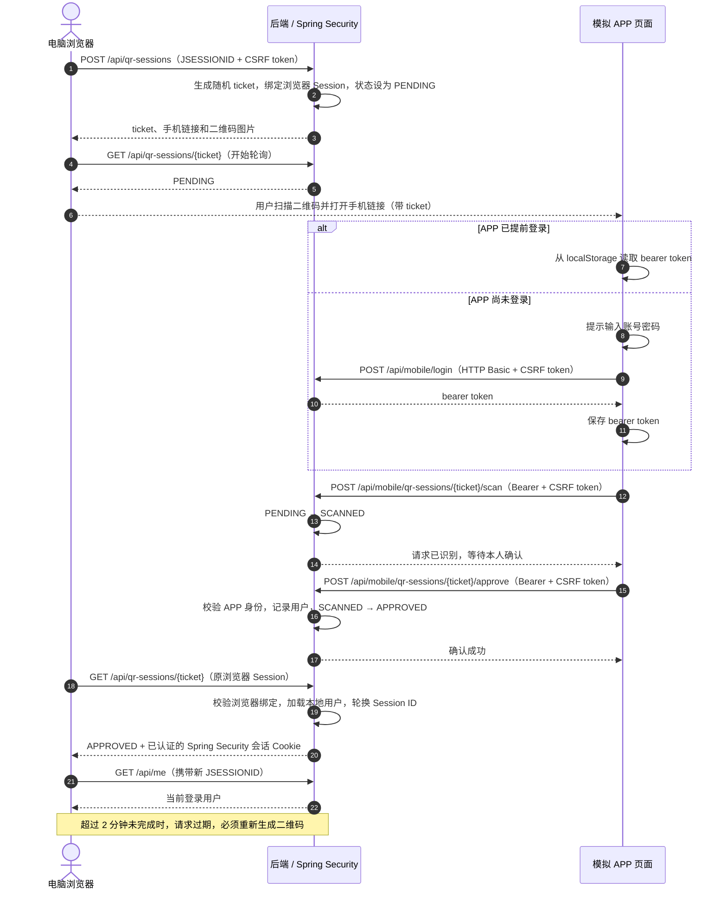

扫码登录的关键，是让后端把手机端的授权结果交给最初发起请求的电脑浏览器。手机端负责确认这次请求，电脑端再通过自己的浏览器会话完成登录。

本文先说明扫码登录的参与方、状态和安全边界，再介绍使用 Spring Initializr 或 `spring-boot-developer` 技能创建项目，并逐步实现扫码票据、手机确认和浏览器登录。示例使用 Spring Boot 4.1.2、Spring Security；手机端由网页模拟，因此不需要真实 App。完整代码见 [GitHub 示例仓库](https://github.com/zhijunio/spring-security-qr-login-demo)。代码用于学习，不应直接作为生产登录系统部署。

<!--more-->

## 一、先理解扫码登录原理

### 两个客户端，一个后端

流程里有三种不同的东西：

- **扫码票据**：二维码里携带的短期随机值，用来找到这次登录请求。拿到票据不等于已经登录。
- **扫码会话**：后端保存的请求状态，记录票据、发起请求的浏览器会话、过期时间和批准用户。
- **Spring Security 会话**：登录成功后，浏览器后续请求用它维持认证状态。

> 扫码只表示手机识别了电脑端的登录请求，不代表登录完成；必须由已认证用户明确确认。


*图：扫码票据只关联这次登录请求；确认后，电脑浏览器使用自己的会话。配图使用 [Ian Xiaohei Illustrations](https://github.com/helloianneo/ian-xiaohei-illustrations) 技能生成。*

下面的时序图展示完整交互。模拟 APP 可以先登录并取得自己的 bearer token；电脑浏览器的 `JSESSIONID`、二维码里的 `ticket`、APP 的 bearer token 分别承担浏览器会话、扫码请求关联和 APP 身份认证，不能相互替代。



示例实现的状态如下：

| 状态 | 含义 | 触发方式 |
| --- | --- | --- |
| `PENDING` | 等待扫码 | 创建扫码会话 |
| `SCANNED` | 已扫码，等待确认 | 手机端提交扫码请求 |
| `APPROVED` | 用户已确认 | 手机端通过认证后批准请求 |
| `EXPIRED` | 请求已过期 | 超过两分钟后查询该会话 |

正常路径是 `PENDING → SCANNED → APPROVED`；未完成的请求超时后进入 `EXPIRED`。当前示例没有实现用户拒绝和主动取消，生产流程应增加 `REJECTED`、`CANCELLED` 等终态，并确保终态不能再批准或消费。[常见扫码登录状态也会包含取消授权](https://docs.authing.co/v2/concepts/how-qrcode-works.html)。

> 状态转换由服务端完成。浏览器不能仅凭前端显示的状态声称登录成功；只有原浏览器会话完成校验后，才能建立登录态。

电脑页每 1.2 秒短轮询一次状态，便于本地演示和理解“原浏览器如何收到授权结果”。代价是等待期间会重复发送请求，并且状态变化最迟要等下一次轮询才能显示。高并发场景可评估长轮询、SSE 或 WebSocket：它们能减少无效查询或更快推送状态，但会增加连接管理和部署复杂度；具体选择还要结合并发量、网关超时和断线重连要求。这里不实现这些方案。

### Spring Security 在流程中的职责

Spring Security 不会自动提供扫码登录。它负责认证身份、建立并保存浏览器的 `SecurityContext`、管理 HTTP Session 和保护接口；二维码票据、扫码状态机、确认规则以及浏览器与手机之间的关联，属于应用需要实现的登录业务。

> Spring Security 负责认证和浏览器会话；扫码票据、状态流转与手机到电脑的请求关联由应用实现。

手机端认证后，后端只记录它对这条短时、绑定原浏览器的请求的批准；原浏览器再由服务端建立独立的 Spring Security 会话。手机凭证不会被复制到电脑端。

### CSRF 在示例中的位置

示例中的桌面页先请求 `GET /api/csrf`，手机页请求 `GET /api/mobile/csrf`。响应包含 CSRF 请求头名称和 token；页面在创建扫码会话、手机登录、扫码、批准和退出等 POST 请求中，将 token 放进指定请求头。相关代码见 `app.js`、`mobile.js` 和 `SecurityConfig.java`。桌面端使用浏览器 Session Cookie，因此不能省略 CSRF 校验；手机页面也按示例配置携带 token。

## 二、创建示例项目：两种方式

### 开始前准备

需要 Java 25 和一个现代浏览器。项目带有 Maven Wrapper，因此不必预先安装 Maven；第一次运行时 Wrapper 会下载所需的 Maven 版本。手机端由网页模拟，整个流程可以在同一台电脑、同一个浏览器中完成。若要用真实手机扫描，请再准备一台能访问电脑局域网地址的手机。

先确认 Java 版本：

```bash
java -version
```

输出应包含 `25`。如果本机没有 Java 25，可先安装相应 JDK，再继续下面任一创建方式。

### 方式一：使用 Spring Initializr 创建基础项目

访问 [start.spring.io](https://start.spring.io)，按下面的参数生成基础项目：

| 选项 | 设置 |
| --- | --- |
| Project | Maven |
| Language | Java |
| Spring Boot | 4.1.2 |
| Group | `com.example` |
| Artifact | `spring-security-qr-login-demo` |
| Package name | `com.example.qrlogindemo` |
| Packaging | Jar |
| Java | 25 |
| Dependencies | Spring Web、Spring Security |

下载并解压后，可以先运行空项目确认 Java 和 Maven 环境正常：

```bash
./mvnw spring-boot:run
```

Spring Initializr 提供的是 Web 与安全基础设施，扫码登录逻辑需要在应用中实现。二维码图片由示例使用 ZXing 生成，因此还要在 `pom.xml` 的 `<dependencies>` 中加入：

```xml
<dependency>
    <groupId>com.google.zxing</groupId>
    <artifactId>javase</artifactId>
    <version>3.5.4</version>
</dependency>
```

若使用这种方式跟着本文手工实现，请按 `src/main/java/com/example/qrlogindemo/` 的包结构添加类，并将页面文件放入 `src/main/resources/static/`。

项目完成后的主要文件职责如下。按 Initializr 手工创建时，可以用这张表逐个对照；各文件链接指向 GitHub 上的完整实现：

| 文件 | 职责 |
| --- | --- |
| [`QrLoginSessionService.java`](https://github.com/zhijunio/spring-security-qr-login-demo/blob/main/src/main/java/com/example/qrlogindemo/auth/QrLoginSessionService.java) | 生成票据，绑定浏览器会话，维护状态和两分钟过期时间 |
| [`QrLoginController.java`](https://github.com/zhijunio/spring-security-qr-login-demo/blob/main/src/main/java/com/example/qrlogindemo/auth/QrLoginController.java) | 创建二维码会话、生成二维码图片、扫码/批准接口、浏览器轮询及登录完成 |
| [`MobileAppTokenService.java`](https://github.com/zhijunio/spring-security-qr-login-demo/blob/main/src/main/java/com/example/qrlogindemo/auth/MobileAppTokenService.java) 与 [`MobileBearerTokenFilter.java`](https://github.com/zhijunio/spring-security-qr-login-demo/blob/main/src/main/java/com/example/qrlogindemo/auth/MobileBearerTokenFilter.java) | 签发、验证和撤销模拟 APP 的 bearer token |
| [`SecurityConfig.java`](https://github.com/zhijunio/spring-security-qr-login-demo/blob/main/src/main/java/com/example/qrlogindemo/config/SecurityConfig.java) | 配置模拟用户、手机无状态 API 与电脑 Session 登录两条安全过滤链 |
| [`src/main/resources/static/`](https://github.com/zhijunio/spring-security-qr-login-demo/tree/main/src/main/resources/static) | 电脑登录页、手机模拟页、前端脚本与蓝白主题样式 |
| [`pom.xml`](https://github.com/zhijunio/spring-security-qr-login-demo/blob/main/pom.xml) 与 [`application.yaml`](https://github.com/zhijunio/spring-security-qr-login-demo/blob/main/src/main/resources/application.yaml) | Spring 依赖、ZXing 和服务端口/手机可访问地址配置 |

### 方式二：使用 `spring-boot-developer` 技能生成项目

如果你在使用支持 Skills 的 Codex，可以先从 [spring-boot-developer 技能仓库](https://github.com/zhijunio/skills/tree/main/spring-boot-developer)安装该技能，再把下面的提示词发给 Codex。技能会根据项目约定创建 Spring Boot 应用；提示词明确了本文示例的版本、扫码流程和模拟 APP 要求：

```text
请使用 spring-boot-developer 技能，在当前目录创建一个名为 spring-security-qr-login-demo 的独立示例项目。

要求：
- 使用 Spring Boot 4.1.2、Java 25 和 Maven，包含 Spring Web、Spring Security，并使用 ZXing 生成二维码。
- 实现电脑浏览器发起扫码登录、手机端扫描并明确确认、原电脑浏览器轮询后建立独立 Spring Security HTTP Session 的完整流程。
- 二维码票据使用安全随机值，有效期 2 分钟，并绑定发起请求的浏览器 Session；服务端实现 PENDING、SCANNED、APPROVED、EXPIRED 状态流转和必要校验。
- 提供 mobile.html 模拟 APP，支持“扫码前已登录”和“扫码后再登录”两种演示路径。演示账号使用 demo / changeit，并清楚说明它仅用于本地演示。
- 前端使用蓝白配色；README.md 默认英文，并提供 README.zh-CN.md；使用 Apache License 2.0；不要添加 CI 配置。
- 保持实现适合本地教学演示，并在文档中说明内存存储等生产限制。
```

下面从后端核心流程开始实现。

## 三、实现扫码登录

下面列出实现流程的几个核心方法。DTO、异常处理、CSRF 配置和页面代码可对照上一节的文件表查看。

### 1. 创建不可猜测、短时有效的票据

服务端用 `SecureRandom` 生成 256 位随机票据，设置两分钟有效期，并把它绑定到发起请求的浏览器 HTTP Session：

完整实现位于 [`QrLoginSessionService.java`](https://github.com/zhijunio/spring-security-qr-login-demo/blob/main/src/main/java/com/example/qrlogindemo/auth/QrLoginSessionService.java)。

```java
public QrLoginSession create(String browserSessionId) {
    Instant now = clock.instant();
    sessions.entrySet().removeIf(entry -> !entry.getValue().expiresAt().isAfter(now));

    byte[] bytes = new byte[32];
    random.nextBytes(bytes);
    String ticket = Base64.getUrlEncoder().withoutPadding().encodeToString(bytes);
    QrLoginSession session = new QrLoginSession(
            ticket, browserSessionId, now.plus(Duration.ofMinutes(2)), State.PENDING, null);
    sessions.put(ticket, session);
    return session;
}
```

创建接口同时生成二维码要打开的手机页面地址：

接口及二维码图片生成逻辑位于 [`QrLoginController.java`](https://github.com/zhijunio/spring-security-qr-login-demo/blob/main/src/main/java/com/example/qrlogindemo/auth/QrLoginController.java)。

```java
@PostMapping("/qr-sessions")
QrSessionResponse create(HttpServletRequest request) {
    QrLoginSession session = sessions.create(request.getSession(true).getId());
    String mobileUrl = publicBaseUrl + "/mobile.html?ticket=" + session.ticket();
    return new QrSessionResponse(session.ticket(), session.expiresAt().toString(), mobileUrl);
}
```

二维码只放短时票据和页面地址，不放用户名、密码、Spring Security Session ID 或可长期使用的访问令牌。浏览器请求二维码图片时，后端还会核对票据属于当前浏览器会话。

本示例为了让手机模拟页直接读取票据，把 `ticket` 放在 URL 查询参数中。它本身不等于登录凭证，但短时、随机和绑定浏览器会话仍不能消除 URL 泄露：查询参数可能进入浏览器历史、代理访问日志、错误监控或 Referer。生产实现应尽量避免把用于关联登录请求的票据放在 URL 查询参数中；例如把一次性短码放入 URL fragment，由页面脚本读取后立即清除地址栏，再通过 POST 请求体提交给后端；后续扫码、确认接口也不要把票据拼进 URL。同时在代理和应用日志中屏蔽票据，并设置严格的 `Referrer-Policy`。票据仍应短时有效、绑定原浏览器请求，并在确认后一次性消费。

### 2. 扫码只标记请求，不完成登录

手机网页从二维码 URL 读出 `ticket`，调用扫码接口。服务端只把活跃的 `PENDING` 请求改为 `SCANNED`：

状态更新在 `QrLoginSessionService.scan` 中完成，HTTP 接口位于 `QrLoginController.scan`；手机页面调用逻辑见 [`mobile.js`](https://github.com/zhijunio/spring-security-qr-login-demo/blob/main/src/main/resources/static/mobile.js)。

```java
public QrLoginSession scan(String ticket) {
    return sessions.compute(ticket, (key, session) -> {
        requireLive(session);
        if (session.state() == State.PENDING) {
            return session.withState(State.SCANNED, null);
        }
        return session;
    });
}
```

这一步不认证用户、不建立电脑端登录会话。手机网页模拟 APP：用户可以先在 `/mobile.html` 登录，演示端通过 Basic 认证换取有效期为 12 小时的 bearer token 并保存在浏览器本地；之后扫码和批准都使用这个 token。这样可以直观演示“APP 已登录，再扫码确认”。真实产品应由后端验证 APP 的现有登录凭证，不要信任页面自行提交的用户名，也不要把这个演示 token 存储方案直接用于生产。

示例把手机 API 配成无状态认证。由于模拟手机页可能和电脑页处于同一浏览器，二者共享 `JSESSIONID`；手机登录不能轮换或替换电脑的 Session ID，否则电脑端绑定的扫码请求会失效。配置中因此对这条无状态 API 链使用无会话固定策略。手机 API 登录成功后使用独立 bearer token，而浏览器网页登录仍使用自己的 Spring Security Session。

### 3. 认证后批准这次请求

批准接口要求 Spring Security 已认证的用户。服务端只允许将 `SCANNED` 状态变为 `APPROVED`，并将已认证的用户名存入请求：

批准接口完整代码见 [`QrLoginController.approve`](https://github.com/zhijunio/spring-security-qr-login-demo/blob/main/src/main/java/com/example/qrlogindemo/auth/QrLoginController.java) 和 `QrLoginSessionService.approve`。

```java
@PostMapping("/mobile/qr-sessions/{ticket}/approve")
Map<String, String> approve(@PathVariable String ticket, Authentication authentication) {
    return Map.of(
            "state",
            sessions.approve(ticket, authentication.getName()).state().name());
}
```

服务层再次检查请求未过期且状态正确，避免未扫码、过期或无效的请求被批准：

```java
public QrLoginSession approve(String ticket, String username) {
    return sessions.compute(ticket, (key, session) -> {
        requireLive(session);
        if (session.state() != State.SCANNED) {
            throw new ResponseStatusException(
                    HttpStatus.CONFLICT, "QR session must be scanned before approval");
        }
        return session.withState(State.APPROVED, username);
    });
}
```

`ConcurrentHashMap.compute` 让单个票据的状态更新在当前进程内原子执行。生产环境若有多个应用实例，应改用共享存储和原子条件更新，并设计过期清理与一次性消费；单机内存 Map 无法跨实例工作。

### 4. 由原浏览器轮询并建立 Spring Security 身份

电脑页面定时查询状态。查询接口先核对浏览器 Session ID，再检查是否已批准。只有发起扫码请求的那个浏览器会话能完成登录：

状态查询与登录上下文保存均在 [`QrLoginController.java`](https://github.com/zhijunio/spring-security-qr-login-demo/blob/main/src/main/java/com/example/qrlogindemo/auth/QrLoginController.java)；过滤链、CSRF 与无状态手机 API 配置见 [`SecurityConfig.java`](https://github.com/zhijunio/spring-security-qr-login-demo/blob/main/src/main/java/com/example/qrlogindemo/config/SecurityConfig.java)。

```java
@GetMapping("/qr-sessions/{ticket}")
QrStatus status(
        @PathVariable String ticket,
        HttpServletRequest request,
        HttpServletResponse response,
        Authentication currentAuthentication) {
    QrLoginSession session = sessions.findForBrowser(ticket, sessionId(request));
    if (session.state() == State.APPROVED
            && (currentAuthentication == null
                    || currentAuthentication instanceof AnonymousAuthenticationToken)) {
        authenticateBrowser(session.username(), request, response);
    }
    return new QrStatus(session.state().name(), session.expiresAt().toString());
}
```

批准结果不是直接返回给浏览器一个可随意兑换的访问令牌。后端重新加载本地用户及其权限，创建 Spring Security `Authentication` 和 `SecurityContext`，轮换 Session ID，然后保存上下文：

```java
private void authenticateBrowser(
        String username, HttpServletRequest request, HttpServletResponse response) {
    UserDetails user = users.loadUserByUsername(username);
    Authentication authentication = UsernamePasswordAuthenticationToken.authenticated(
            user, null, user.getAuthorities());
    request.changeSessionId();
    SecurityContext context = SecurityContextHolder.createEmptyContext();
    context.setAuthentication(authentication);
    SecurityContextHolder.setContext(context);
    contexts.saveContext(context, request, response);
}
```

后续访问 `/api/me` 时，Spring Security 从 HTTP Session 恢复认证身份；扫码票据和批准状态仍由应用维护。

## 四、运行并验证流程

项目使用 Maven Wrapper 和 Java 25：

```bash
git clone https://github.com/zhijunio/spring-security-qr-login-demo.git
cd spring-security-qr-login-demo
./mvnw spring-boot:run
```

如果项目已通过 Spring Initializr 创建，则在项目根目录直接运行最后一条命令。Windows 命令行使用 `mvnw.cmd spring-boot:run`。

访问 <http://localhost:8080> 后，电脑端会创建扫码会话并显示二维码。下面是二维码登录页截图；实际操作时，每次访问都会生成新的短时二维码：


### 路径 A：提前登录模拟 APP，再扫码

示例没有真实手机 App，而是用 `mobile.html` 模拟 App 的登录界面与已登录状态。启动服务后，在浏览器打开 <http://localhost:8080/mobile.html>：


使用演示账号 `demo`、密码 `changeit`，点击“登录模拟 APP”。该账号由 `SecurityConfig` 中的 `InMemoryUserDetailsManager` 提供，只用于本地演示。登录表单通过 HTTP Basic 向 `POST /api/mobile/login` 提交凭证；后端用 Spring Security 校验账号密码，成功后返回一个随机 bearer token。页面把 token 暂存在浏览器 `localStorage`，有效期为 12 小时，之后扫码、确认等手机 API 请求通过 `Authorization: Bearer ...` 携带它。示例没有把密码放进二维码，也不会把 APP token 交给电脑浏览器。

登录成功后页面显示当前 APP 用户：


在同一浏览器用两个标签模拟电脑和手机：

1. 保持一个标签页显示 `APP 已登录 demo`。
2. 打开另一个标签页访问 <http://localhost:8080>，等待二维码出现。
3. 用手机模拟页打开二维码中的链接。可以用系统扫码器扫描屏幕，也可以在浏览器中打开二维码图片对应的 `mobileUrl`。同一浏览器的同源页面共享 `localStorage`，已登录的模拟 APP 会自动携带 token 调用扫码接口。
4. 手机模拟页显示“请求已识别”及“确认并登录电脑”按钮。核对请求后点击确认。
5. 回到电脑标签页，轮询收到批准结果并建立该浏览器自己的 Spring Security Session；此时 `/api/me` 应返回 `demo`。

> 两个标签页只是演示，不等于两台独立设备：同源网页共享 `localStorage`。真实 App 的凭证存储、设备绑定和凭证生命周期需要单独设计；不要照搬此处的网页 token 存储方式。

> 真实 App 应使用平台安全存储管理凭证，并由服务端校验 token 的有效期、撤销状态和用户身份。本文不覆盖设备绑定、App 完整性校验和凭证刷新。

### 路径 B：不提前登录，扫码后再登录模拟 APP

这条路径演示扫码时手机尚未登录的情况。若刚完成路径 A，先在模拟 APP 页面点“退出”；如电脑端也已登录，退出电脑账号或改用新的浏览器会话。然后操作：

1. 打开电脑登录页 <http://localhost:8080>，等待新的二维码出现。
2. 用系统扫码器扫描二维码，或在浏览器中打开二维码包含的手机链接 `mobile.html?ticket=...`，将本次登录票据带到手机模拟页。
3. 页面显示账号密码表单。输入 `demo / changeit` 并点击“登录模拟 APP”。后端完成认证并返回有效期 12 小时的 bearer token；页面保存 token 后，会自动用它将当前二维码请求标记为已扫描。
4. 页面显示“请求已识别”及“确认并登录电脑”按钮。核对请求后点击确认。
5. 回到电脑页，等待轮询完成登录；`/api/me` 应返回 `demo`。

两条路径的区别在于取得 APP token 的时间：路径 A 在扫码前已登录，路径 B 在扫码后登录。两条路径都必须由用户点击确认；每个二维码两分钟过期，过期后回电脑页刷新二维码再试。

### 如何确认登录成功

两条路径都应看到以下结果：手机模拟页先显示请求已识别，再显示确认成功；电脑页随后显示已登录用户 `demo`。也可以在电脑端打开 <http://localhost:8080/api/me>，响应应为：

```json
{"username":"demo"}
```

如果电脑页仍显示登录二维码，先确认手机端已点击确认，并检查二维码是否已超过两分钟。路径 B 在扫描后出现账号密码表单是预期行为；登录模拟 APP 成功后，页面会自动继续标记扫码状态。

### 自动化测试的边界

仓库当前没有 `src/test` 自动化测试源码。上面的步骤只能人工确认两条成功路径，不能证明错误和并发场景都被正确拒绝。扩展示例时，至少应为以下行为增加服务层或集成测试：票据过期后扫码/批准失败；其他浏览器会话不能完成登录；未扫码时批准返回冲突；缺失或错误的 CSRF Token 被拒绝；同一票据被重复或并发批准时只有一次成功。执行 `./mvnw test` 前应先添加这些测试；仅运行 Maven 命令本身不能替代这些断言。

如果使用真实手机访问本机服务，手机和电脑必须处于可互相访问的网络，并把 `APP_PUBLIC_BASE_URL` 设置成手机可访问的电脑局域网地址；不能用手机访问其自身的 `localhost`。例如电脑的局域网地址是 `192.168.1.20`：

```bash
APP_PUBLIC_BASE_URL=http://192.168.1.20:8080 ./mvnw spring-boot:run
```

生产网络必须使用 HTTPS。

## 安全检查清单

- **随机且短期**：票据不可预测，绑定浏览器会话并设置过期时间；过期后拒绝扫码、批准和登录。
- **明确确认**：扫码只表示打开了请求，必须由认证用户确认后才批准。
- **请求防伪**：有状态的浏览器会话与手机确认接口启用 CSRF 防护；批准请求需要正确的 CSRF Token。
- **会话固定防护**：登录成功后轮换浏览器 Session ID，再保存 Security Context。
- **一次性状态**：生产实现应让批准和消费状态不可重复使用，并确保并发请求只有一个成功。
- **传输与存储**：只通过 HTTPS 传递凭据；生产环境将请求状态放到具备 TTL 和原子更新能力的共享存储，避免日志记录票据或认证信息。
- **用户核验**：手机确认页应显示足够的信息帮助用户判断这是本人发起的登录，并提供拒绝入口。

## 总结

- 扫码登录是手机端对电脑端请求进行授权的跨设备流程。扫码不等于批准；已认证的手机用户确认后，原电脑浏览器才建立自己的会话。
- 二维码 ticket、手机 bearer token 和浏览器 Session 各自承担不同职责。Spring Security 负责认证与浏览器会话，扫码状态流转由应用实现。
- 本示例使用内存状态和网页模拟 APP，且没有自动化测试，适合本地学习，不应直接用于生产。生产环境还需完善拒绝/取消、票据保护、并发与共享存储，以及真实 APP 的凭证管理。
