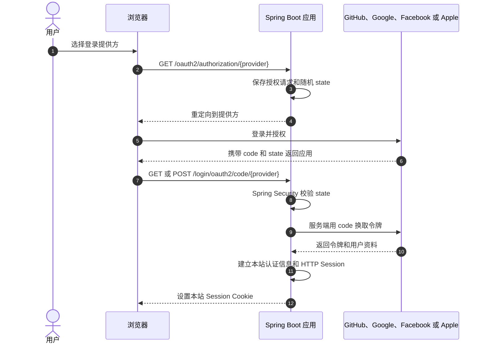

社交登录让用户使用已有的第三方账号登录网站。网站把用户浏览器跳转到身份提供方，完成授权后再由 Spring Security 处理回调，并在本站建立自己的登录会话。

本文以 [spring-security-social-login-demo](https://github.com/zhijunio/spring-security-social-login-demo) 为例，介绍如何配置 GitHub、Google、Facebook 和 Apple 登录，逐步阅读客户端注册、Spring Security 配置与用户资料映射代码。示例使用 Spring Boot 4.1.2、Java 25、Maven 和 Thymeleaf。

<!--more-->

## 社交登录的授权码流程

浏览器应用通常使用 OAuth 2.0 授权码流程接入社交登录。Spring Security 的 OAuth2 Login 会把用户带到提供方完成认证和授权，再处理授权回调。[Spring Security OAuth2 Login 文档](https://docs.spring.io/spring-security/reference/servlet/oauth2/login/index.html)



第三方授权成功后，应用会读取提供方返回的用户标识，并建立本站登录会话。这个标识不会自动成为本站账号；应用仍需决定如何映射本站账号、分配角色和管理用户生命周期。本示例只展示提供方登录和本站 Session，不包含这些业务。

## 先运行现成项目

如果你想先看到登录流程，再阅读实现代码，先使用 GitHub 完成一次登录。GitHub OAuth App 支持本地回调地址，步骤比需要 HTTPS 域名的 Apple 登录少。


*图：示例首页展示已配置的社交登录入口。截图中的凭证是界面演示值，不能完成真实授权；请按下文配置自己的 OAuth 客户端。*

1. 安装 Java 25。项目带有 Maven Wrapper，不需要单独安装 Maven。
2. 在 GitHub 打开 **Settings → Developer settings → OAuth Apps → New OAuth App**。
3. 将 **Homepage URL** 设为 `http://localhost:8080`，将 **Authorization callback URL** 设为 `http://localhost:8080/login/oauth2/code/github`。
4. 创建应用，并复制 Client ID。然后生成 Client Secret。
5. 克隆项目并创建本地配置文件：

   ```bash
   git clone https://github.com/zhijunio/spring-security-social-login-demo.git
   cd spring-security-social-login-demo
   cp .env.sample .env
   ```

6. 在 `.env` 中填写 `GITHUB_CLIENT_ID` 和 `GITHUB_CLIENT_SECRET`。
7. 启动应用：

   ```bash
   ./mvnw spring-boot:run
   ```

8. 打开 <http://localhost:8080>，点击 GitHub 登录并完成授权。浏览器返回首页后，应显示 GitHub 用户名和登录提供方。点击登出后，本站会话结束。

不要把 `.env` 或真实凭证提交到 Git。若首页没有 GitHub 登录按钮，检查 Client ID 和 Client Secret 是否都已填写，并在修改 `.env` 后重启应用。若 GitHub 报回调地址不匹配，请核对开发者设置中的地址与请求地址是否完全相同。

## 创建项目

可以使用 Spring Initializr 创建项目，也可以使用 `spring-boot-developer` 技能生成项目，再用 `oil-ui` 技能设计登录页面。

在 [Spring Initializr](https://start.spring.io/) 中选择 Maven、Java、Spring Boot 4.1.2 和 Java 25，并添加 Spring Security、OAuth2 Client、Spring Web MVC 和 Thymeleaf。对应的主要依赖如下：

```xml
<dependency>
    <groupId>org.springframework.boot</groupId>
    <artifactId>spring-boot-starter-security</artifactId>
</dependency>
<dependency>
    <groupId>org.springframework.boot</groupId>
    <artifactId>spring-boot-starter-security-oauth2-client</artifactId>
</dependency>
<dependency>
    <groupId>org.springframework.boot</groupId>
    <artifactId>spring-boot-starter-thymeleaf</artifactId>
</dependency>
<dependency>
    <groupId>org.springframework.boot</groupId>
    <artifactId>spring-boot-starter-webmvc</artifactId>
</dependency>
```

使用 Codex Skills 时，先安装 [`spring-boot-developer`](https://github.com/zhijunio/skills/tree/main/spring-boot-developer) 和 [`oil-ui`](https://github.com/oil-oil/oil-ui)，然后使用下面的提示词：

```text
请使用 spring-boot-developer 技能创建一个 Spring Boot 社交登录示例项目，使用 Spring Boot 4.1.2、Java 25 和 Maven。

要求：
- 使用 Spring Security OAuth2 Client 的 oauth2Login 实现 Authorization Code 登录。
- 支持 GitHub、Google、Facebook 和 Apple；凭证只从环境变量读取，未配置的提供方不显示。
- 保留 Spring Security 的 state 校验、Session 管理、CSRF 和安全登出。
- Apple 使用 OIDC；仅为 Apple 配置 response_mode=form_post，并说明 HTTPS、Cookie SameSite 和回调要求。
- 使用 oil-ui 技能设计蓝白配色的服务端登录页面。
- 提供中英文 README、Apache License 2.0 和可观察行为测试，不添加 CI 配置。
- 不实现数据库、账号关联、权限映射或本地账号生命周期，并在文档中说明这些限制。
```

## 注册各提供方的客户端

分别在第三方开发者平台创建网站 OAuth 客户端。注册时需要配置应用主页、回调地址和授权范围。回调地址必须与应用使用的协议、域名、端口和路径完全一致。

| 提供方 | 示例回调地址 | 凭证环境变量 | 示例授权范围 |
| --- | --- | --- | --- |
| GitHub | `http://localhost:8080/login/oauth2/code/github` | `GITHUB_CLIENT_ID`、`GITHUB_CLIENT_SECRET` | `read:user` |
| Google | `http://localhost:8080/login/oauth2/code/google` | `GOOGLE_CLIENT_ID`、`GOOGLE_CLIENT_SECRET` | `openid`、`profile`、`email` |
| Facebook | `http://localhost:8080/login/oauth2/code/facebook` | `FACEBOOK_CLIENT_ID`、`FACEBOOK_CLIENT_SECRET` | `public_profile`、`email` |
| Apple | `https://你的域名/login/oauth2/code/apple` | `APPLE_CLIENT_ID`、`APPLE_CLIENT_SECRET` | `openid`、`name`、`email` |

Apple 的网站登录需要 Services ID、HTTPS 域名和使用 `.p8` 私钥签名的 client-secret JWT。`APPLE_CLIENT_SECRET` 因此不是控制台里复制的普通密钥。Facebook 端点使用代码中的 `FACEBOOK_API_VERSION` 常量。示例仓库的[英文 README](https://github.com/zhijunio/spring-security-social-login-demo/blob/main/README.md)和[中文 README](https://github.com/zhijunio/spring-security-social-login-demo/blob/main/README.zh-CN.md)提供各个平台的注册步骤。

不要把客户端密钥、Apple JWT 或 `.p8` 私钥提交到 Git。将 `.env.sample` 复制为 `.env`，再填写所需提供方的凭证：

```dotenv
GITHUB_CLIENT_ID=your-client-id
GITHUB_CLIENT_SECRET=your-client-secret
GOOGLE_CLIENT_ID=
GOOGLE_CLIENT_SECRET=
FACEBOOK_CLIENT_ID=
FACEBOOK_CLIENT_SECRET=
APPLE_CLIENT_ID=
APPLE_CLIENT_SECRET=
```

示例的 `application.yaml` 通过环境变量读取这些值。提供方只有在 Client ID 和 Client Secret 都配置后才会注册；只配置其中一个会让应用启动失败。

## 配置 OAuth 客户端

应用通过 `@ConfigurationPropertiesScan` 载入 `SocialLoginProperties`。`ConfiguredClientRegistrations` 实现 Spring Security 的 `ClientRegistrationRepository`，负责注册已配置的提供方，并向登录页返回可选列表。

阅读代码时，可以从下面几个文件开始：

| 文件 | 作用 |
| --- | --- |
| [`application.yaml`](https://github.com/zhijunio/spring-security-social-login-demo/blob/main/src/main/resources/application.yaml) | 从环境变量读取各提供方凭证和 Session Cookie 配置 |
| [`SocialLoginProperties.java`](https://github.com/zhijunio/spring-security-social-login-demo/blob/main/src/main/java/io/github/zhijunio/sociallogin/config/SocialLoginProperties.java) | 绑定 `social-login` 配置 |
| [`ConfiguredClientRegistrations.java`](https://github.com/zhijunio/spring-security-social-login-demo/blob/main/src/main/java/io/github/zhijunio/sociallogin/config/ConfiguredClientRegistrations.java) | 注册 GitHub、Google、Facebook 和 Apple 客户端 |
| [`SecurityConfig.java`](https://github.com/zhijunio/spring-security-social-login-demo/blob/main/src/main/java/io/github/zhijunio/sociallogin/config/SecurityConfig.java) | 配置登录入口、Apple 回调和授权规则 |
| [`LoginPageController.java`](https://github.com/zhijunio/spring-security-social-login-demo/blob/main/src/main/java/io/github/zhijunio/sociallogin/web/LoginPageController.java) | 为首页准备匿名、失败或已登录状态 |
| [`SocialProfileMapper.java`](https://github.com/zhijunio/spring-security-social-login-demo/blob/main/src/main/java/io/github/zhijunio/sociallogin/profile/SocialProfileMapper.java) | 将提供方属性映射为页面显示的名称和头像 |
| [`index.html`](https://github.com/zhijunio/spring-security-social-login-demo/blob/main/src/main/resources/templates/index.html) | 使用 Thymeleaf 渲染登录和用户资料页面 |

GitHub 和 Google 使用 `CommonOAuth2Provider` 的预设值。Facebook 也从预设构建客户端，但覆盖授权、令牌和用户信息端点，因为该预设使用的 Graph API 版本已过旧。Apple 使用显式 OIDC 端点和 `openid`、`name`、`email` 范围。下面摘录客户端注册方法中的分支，省略了外围的 `switch` 结构：

```java
case "github" -> CommonOAuth2Provider.GITHUB
        .getBuilder(id)
        .clientId(credentials.clientId())
        .clientSecret(credentials.clientSecret())
        .redirectUri(REDIRECT_URI)
        .scope("read:user")
        .build();
case "facebook" -> facebookRegistration(id, credentials);
case "apple" -> oidc(
        id,
        "Apple",
        credentials,
        "https://appleid.apple.com",
        "https://appleid.apple.com/auth/authorize",
        "https://appleid.apple.com/auth/token",
        null,
        "https://appleid.apple.com/auth/keys",
        List.of("openid", "name", "email"));
```

回调 URI 使用 Spring Security 默认的 `/login/oauth2/code/{registrationId}` 模式。登录入口使用 `/oauth2/authorization/{registrationId}`。提供方登录按钮链接到对应入口，由 Spring Security 生成授权请求并保存 `state`。

## 配置 Spring Security

`SecurityConfig` 开放首页和静态资源，其余请求要求认证。`oauth2Login()` 启用 OAuth2 登录，登录失败后回到首页显示通用错误信息。登出仍由 Spring Security 处理，并受 CSRF 保护。

```java
return http
        .authorizeHttpRequests(authorize -> authorize
                .requestMatchers("/", "/assets/**", "/error", "/favicon.ico").permitAll()
                .anyRequest().authenticated())
        .oauth2Login(oauth2 -> oauth2
                .authorizationEndpoint(endpoint -> endpoint
                        .authorizationRequestResolver(authorizationRequestResolver))
                .failureUrl("/?error"))
        .logout(logout -> logout.logoutSuccessUrl("/"))
        .build();
```

Apple 使用 `response_mode=form_post`，因此授权服务器会以跨站 POST 请求提交回调。示例只对 `/login/oauth2/code/apple` 的 POST 回调忽略 CSRF，并保留 Spring Security 对 OAuth `state` 的校验。Apple 生产回调还需要 HTTPS 和 `SameSite=None; Secure` Session Cookie。不要为其他回调或应用 API 关闭 CSRF。

## 显示登录用户资料

登录成功后，`LoginPageController` 从 `OAuth2AuthenticationToken` 取得注册 ID，再把 principal 的属性交给 `SocialProfileMapper`。映射器优先选择 `name` 或 `preferred_username`，然后根据提供方使用合适的备用名称。

头像地址不直接信任提供方属性。映射器只接受 HTTPS、无端口和用户信息的 URI，并限制 GitHub、Google 与 Facebook 的头像主机名。页面使用 Thymeleaf 的转义输出展示名称和头像地址，不把 access token 放进页面。

Apple 姓名有一个示例限制：虽然请求了 `name` scope，但当前代码只读取 Spring Security principal 的属性，没有解析 Apple 首次授权回调中的额外 `user` 参数。因此页面可能显示 `Apple account`。真实应用需要在首次授权时接收并保存用户资料；本示例没有数据库，也不保存本地用户资料。

## 验证

快速验证时，按“先运行现成项目”一节使用 GitHub 登录。登录成功后，页面显示映射后的用户资料；登出后，应用返回匿名状态。本站登出只清除本应用 Session，不会退出第三方账号。

运行项目测试，检查已配置提供方按钮、授权请求、失败提示、资料展示和 CSRF 登出：

```bash
./mvnw test
```

这些测试不会访问真实的第三方平台，也不能替代使用真实凭证完成的授权码往返验证。

## 示例范围

本项目适合学习 Spring Security OAuth2 Client 的浏览器登录流程。它没有数据库、本地账号生命周期、账号关联、角色映射、应用 JWT 或资源服务器。生产应用还需要定义稳定的外部身份键、本站账号策略和授权规则。

不同提供方返回的用户属性和授权范围并不完全相同。上线前应对照各平台当前文档核实回调配置、API 版本、隐私审核和数据使用要求。
