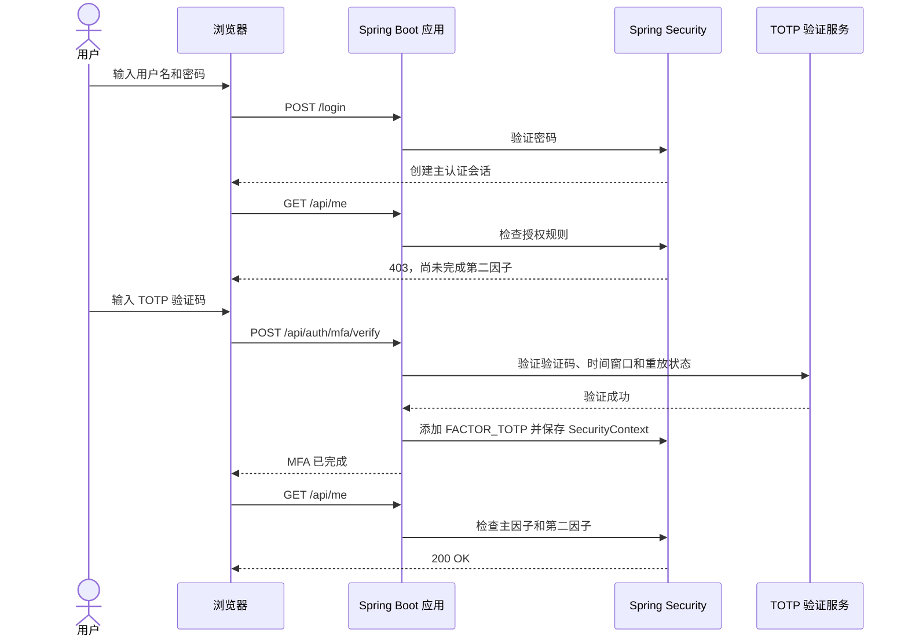

这篇文章从一个最小的 Spring Boot Web 项目开始，一步步给它加上 MFA：先让用户用密码登录，再验证 TOTP，最后让不同接口根据认证阶段决定是否放行。

示例代码来自 [spring-security-7-mfa-demo](https://github.com/zhijunio/spring-security-7-mfa-demo)。项目使用 Spring Boot 4.1.2、Spring Security 7、Java 25。为了突出 Spring Security 7 的 MFA 接入方式，本文先实现密码 + TOTP 这条主路径，再介绍示例中的邮件码、钱包签名和近期重新验证。项目是本地学习示例，用户和凭证保存在内存中，不适合直接部署到生产环境。

<!--more-->

## 先看最终流程

MFA 不是让前端在密码登录后显示一个输入框就算完成。应用必须在服务端验证第二个凭证，验证成功后更新认证状态，再由授权规则保护业务接口。



接下来按这个流程逐步搭建。若希望直接运行完整示例，可以跳到[运行示例](#运行完整示例)。

## 第一步：创建 Web 项目

在 Spring Initializr 创建 Maven 项目，选择 Java 25 和 Spring Boot 4.1.2，加入 Spring Web MVC 与 Spring Security。示例仓库的核心依赖对应如下：

```xml
<dependency>
    <groupId>org.springframework.boot</groupId>
    <artifactId>spring-boot-starter-webmvc</artifactId>
</dependency>
<dependency>
    <groupId>org.springframework.boot</groupId>
    <artifactId>spring-boot-starter-security</artifactId>
</dependency>
```

示例还使用 WebAuthn、web3j 和 Springdoc 来演示 Passkey、钱包签名与 API 文档；先实现密码 + TOTP 时不需要这些额外依赖。Spring Boot 的依赖管理会为 Spring Security 选择兼容版本，不要单独覆盖 Spring Security 版本。

## 第二步：建立最小登录和授权规则

先配置一个内存用户和普通的表单登录。下面的代码展示关键配置；示例中的用户 `demo` / `changeit` 仅用于本地体验：

```java
@Configuration
@EnableMultiFactorAuthentication(authorities = {})
class SecurityConfig {
    @Bean
    PasswordEncoder passwordEncoder() {
        return PasswordEncoderFactories.createDelegatingPasswordEncoder();
    }

    @Bean
    UserDetailsService users(PasswordEncoder encoder) {
        return new InMemoryUserDetailsManager(User.withUsername("demo")
            .password(encoder.encode("changeit"))
            .roles("USER")
            .build());
    }

    @Bean
    SecurityContextRepository securityContextRepository() {
        return new HttpSessionSecurityContextRepository();
    }

    @Bean
    SecurityFilterChain filterChain(HttpSecurity http) throws Exception {
        return http
            .authorizeHttpRequests(auth -> auth
                .requestMatchers("/", "/login", "/api/csrf", "/api/auth/state").permitAll()
                .anyRequest().authenticated())
            .formLogin(form -> form.loginPage("/").loginProcessingUrl("/login").permitAll())
            .build();
    }
}
```

为什么这里显式写 `authorities = {}`？Spring Security 7 的 `@EnableMultiFactorAuthentication` 可以为授权规则增加一组必需因子；但本文要逐步实现接口级策略，所以不在全局强制统一因子，而是在后续的 URL 规则中指定门槛。MFA 文档也要求应用同时配置“要求哪些因子”的授权规则和“如何完成每个因子”的认证机制，详见 [Spring Security MFA 文档](https://docs.spring.io/spring-security/reference/servlet/authentication/mfa.html)。

密码登录成功后，Spring Security 会将 `FactorGrantedAuthority.PASSWORD_AUTHORITY` 加入 `Authentication`。它表示密码因子已经通过，并不代表 MFA 已经完成。`FactorGrantedAuthority` 的作用是让这些认证结果可以参与授权判断。

## 第三步：为第二因子定义服务端状态

先定义自己的因子标识，例如：

```java
static final String TOTP_FACTOR = "FACTOR_TOTP";
```

下一步需要一个 `MfaService`，负责生成 TOTP 秘钥、确认绑定、校验验证码和防止同一个时间片重复使用。校验逻辑不能只判断“验证码格式是六位数字”：还要检查它是否在允许的时间窗口内、是否已使用过，以及用户是否已完成绑定。

示例的 TOTP 流程是：

1. 用户在完成 MFA 后发起绑定，服务端生成随机秘钥并返回 `otpauth` URI。
2. 用户将 URI 添加到验证器应用，再提交当前验证码确认绑定。
3. 登录后提交 TOTP；服务端验证成功后记录已接受的时间片，拒绝重放。

示例使用 20 字节随机秘钥、6 位码和 30 秒时间片，并接受前后各一个时间片的时钟偏差。秘钥只在内存中保存；真实系统应加密保存，并在绑定时安全地展示二维码或 URI。

> 为了保持教程重点，本文不重复展开 TOTP 的 HMAC/Base32 实现。可直接查看示例仓库中的 [`MfaService`](https://github.com/zhijunio/spring-security-7-mfa-demo/blob/main/src/main/java/com/example/springsecuritymfa/auth/MfaService.java) 和 [`MfaServiceTest`](https://github.com/zhijunio/spring-security-7-mfa-demo/blob/main/src/test/java/com/example/springsecuritymfa/auth/MfaServiceTest.java)。

## 第四步：校验凭证后再添加因子 authority

第二因子的验证接口应先调用对应验证器，只有校验通过，才能把因子加入当前认证。核心更新过程如下：

```java
void markFactorVerified(Authentication current, HttpServletRequest request,
                        HttpServletResponse response) {
    var authorities = new ArrayList<GrantedAuthority>(current.getAuthorities());
    authorities.add(new SimpleGrantedAuthority(TOTP_FACTOR));

    var updated = new UsernamePasswordAuthenticationToken(
        current.getPrincipal(), null, authorities);
    var context = SecurityContextHolder.createEmptyContext();
    context.setAuthentication(updated);
    SecurityContextHolder.setContext(context);

    request.changeSessionId();
    securityContextRepository.saveContext(context, request, response);
}
```

这个方法只能在 TOTP 验证成功后调用。不要把 `TOTP_FACTOR` 从请求中读取，也不要让客户端通过请求体、Cookie 或自定义 Header 声明“我已经完成 MFA”。示例同时更换 session id，并将认证后的 `SecurityContext` 保存到 `HttpSessionSecurityContextRepository`。

你可以把接口拆成两步：`POST /api/auth/mfa/challenge` 负责发放邮件码或钱包签名 challenge；`POST /api/auth/mfa/verify` 接收因子类型和凭证，路由到对应校验器；校验通过后再执行上述状态更新。TOTP 通常不需要单独 challenge。

## 第五步：按认证阶段保护接口

有了密码因子和 TOTP 因子后，定义三个判断：

```java
boolean hasPrimary(Authentication authentication) {
    return authentication != null
        && authentication.isAuthenticated()
        && !(authentication instanceof AnonymousAuthenticationToken)
        && authentication.getAuthorities().stream()
            .map(GrantedAuthority::getAuthority)
            .anyMatch(authority ->
                authority.equals(FactorGrantedAuthority.PASSWORD_AUTHORITY)
                    || authority.equals(FactorGrantedAuthority.WEBAUTHN_AUTHORITY));
}

boolean complete(Authentication authentication) {
    return hasPrimary(authentication)
        && authentication.getAuthorities().stream()
            .anyMatch(authority -> authority.getAuthority().equals(TOTP_FACTOR));
}
```

然后在 `SecurityFilterChain` 按路径应用授权策略：

```java
return http.authorizeHttpRequests(auth -> auth
        .requestMatchers("/", "/login", "/api/csrf", "/api/auth/state").permitAll()
        .requestMatchers("/api/auth/mfa/**")
            .access((authentication, context) ->
                new AuthorizationDecision(hasPrimary(authentication.get())))
        .anyRequest()
            .access((authentication, context) ->
                new AuthorizationDecision(complete(authentication.get()))))
    .formLogin(form -> form.loginPage("/").loginProcessingUrl("/login").permitAll())
    .build();
```

顺序很重要：第二因子接口必须允许“密码已通过、MFA 尚未完成”的用户访问，否则用户无法提交第二个凭证。普通业务接口则要求 `complete(...)` 为真。不要简单把所有请求都 `.authenticated()`，因为那只检查是否登录，不代表通过了第二因子。

## 第六步：给敏感操作增加近期验证

通过 MFA 登录后，用户可能长时间保持会话。添加/删除因子、查看安全设置等操作，可以再要求一次近期 MFA。示例记录验证时间和 subject，并将有效期限制为五分钟：

```java
boolean recent(HttpServletRequest request, Authentication authentication) {
    var session = request.getSession(false);
    if (session == null || authentication == null || !complete(authentication)) {
        return false;
    }

    Object verifiedAt = session.getAttribute(VERIFIED_AT);
    Object subject = session.getAttribute(VERIFIED_SUBJECT);
    if (!authentication.getName().equals(subject) || !(verifiedAt instanceof Instant time)) {
        return false;
    }

    Duration age = Duration.between(time, clock.instant());
    return !age.isNegative() && age.compareTo(Duration.ofMinutes(5)) < 0;
}
```

随后把安全设置与因子管理路由放在更具体的 matcher 中：

```java
.requestMatchers("/api/me/security", "/api/mfa/**", "/webauthn/register/**")
    .access((authentication, context) ->
        new AuthorizationDecision(
            mfa.recent(context.getRequest(), authentication.get())))
```

这条规则放在通用 `anyRequest()` 之前。项目中使用注入的 `Clock` 而不是直接调用系统时间，方便测试过期、未来时间等边界。

## 第七步：不要关掉 CSRF

示例使用服务端 `JSESSIONID` 会话承载认证状态，因此保留 Spring Security 默认 CSRF 防护。前端先请求 `GET /api/csrf`，再将响应中的 token 放到指定 Header，并在后续请求中继续携带同一个 session cookie。登录、MFA 验证、因子绑定和登出等写请求都需要遵循这一约定。

认证流程应返回清楚的错误状态：未登录为 `401`，缺少授权所需阶段为 `403`，无效或过期凭证在示例中以 `application/problem+json` 返回。不要通过返回成功状态来隐藏实际失败，否则前端状态与服务端授权会失去一致性。

## 运行完整示例

仓库已经把以上步骤连成浏览器应用，并额外演示 Passkey 主认证、邮件 OTP、钱包签名和 BIP-39 MFA 凭证。需要 JDK 25：

```bash
git clone https://github.com/zhijunio/spring-security-7-mfa-demo.git
cd spring-security-7-mfa-demo
./mvnw spring-boot:run
```

打开 `http://localhost:8080/`，使用 `demo` / `changeit` 登录。验证前访问受保护的 `GET /api/me` 应被拒绝；完成一个第二因子后再访问应成功。`GET /api/auth/state` 可用于观察 `primaryAuthenticated` 与 `mfaComplete` 两个阶段。写接口先取 CSRF token，且账户、会话之外的因子状态都会在应用重启后清空。

## 从示例走向真实应用

Spring Security 7 提供标准因子表达和授权集成，不会替应用生成或发送所有凭证。邮件服务、TOTP 秘钥生命周期、钱包 challenge、因子恢复和撤销仍由应用负责。正式部署前还要处理：

- 为账户和因子凭证接入持久化、访问控制和加密存储；
- 对挑战与验证码做限流、失败计数、过期和一次性消费，并记录安全审计；
- 配置 HTTPS、安全 Cookie、正确的 WebAuthn RP ID/origin 和正式邮件渠道；
- 设计设备丢失、因子撤销、恢复、轮换，以及密码重置后的会话失效策略；
- 判断因子是否来自不同类别，评估认证器是否满足目标保证等级。

示例的邮件验证码只打印到本地日志；BIP-39 短语是可重复使用的应用凭证，不是一次性恢复码；钱包签名挑战只按本地演示域名配置。请勿把演示凭证或本地参数用于线上。

## 小结

从零接入 MFA，主线只有四步：识别主认证因子、服务端验证第二因子、验证成功后更新认证上下文、用授权规则保护不同接口。近期 MFA、CSRF、会话轮换和恢复策略则补足真实应用中的安全边界。

- [示例项目](https://github.com/zhijunio/spring-security-7-mfa-demo)
- [Spring Security 官方 MFA 文档](https://docs.spring.io/spring-security/reference/servlet/authentication/mfa.html)
- [`@EnableMultiFactorAuthentication` API 文档](https://docs.spring.io/spring-security/reference/api/java/org/springframework/security/config/annotation/authorization/EnableMultiFactorAuthentication.html)
